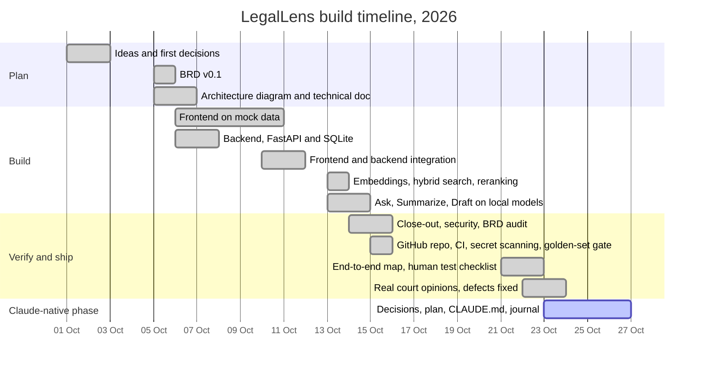

# How LegalLens was built

The real order and dates of the work, from the first idea on 1 October 2026 to today.

**Why this page exists.** This repository was created on 15 October 2026. Everything built before that, from the
first idea to a tested app, was developed on one computer and arrived in a single first commit
([`687ae97`](https://github.com/pandaspace83/legallens/commit/687ae97), 541 files). Git can't show that period, so
this page does. Every date comes from one of three records:

- the dated status line at the top of each plan (`FRONTEND_TODO.md`, `BACKEND_TODO.md`, `INTEGRATION_TODO.md` and the
  others);
- the Claude Code session logs from that period, summarised here (no raw transcripts);
- the git history and pull requests from 15 October onward.

## How I worked

- **Direction.** I wrote the prompts that drove every phase, from the first idea to the Claude-native phase, and
  guided the work: I answered the design questions, decided or approved the choices recorded in [IDEAS.md](IDEAS.md)
  (96 numbered decisions so far), and reviewed and tested each phase.
- **Method.** Spec first: ideas, then a BRD, then the architecture, then a TODO plan for each layer that I approved
  before any code was written, then tests at every layer and an audit of what was built against the BRD.
- **AI pair.** The code was written with Claude Code, and every commit credits it as co-author. From 23 October the
  working rule changed: in the Claude-native phase I write the code and Claude guides and reviews
  ([PHASE2_TODO.md](PHASE2_TODO.md)). What I learn along the way is logged in [LEARNING_JOURNAL.md](LEARNING_JOURNAL.md).

## Timeline

## Day by day

| Date | What happened | Evidence |
|---|---|---|
| 1 Oct | Wrote the first prompt for LegalLens: an assistant that can Ask, Summarize and Draft, for one US lawyer working in one workspace. Answered the first design questions (who the user is, which courts, which documents). | [IDEAS.md](IDEAS.md) |
| 2 Oct | Decided that no data goes to an outside AI: all models run locally. Tightened the drafting rules: a draft may not add law from the model's own knowledge (`[CITE NEEDED]`, `[RULE NEEDED]`), and citations from the other side are not trusted. | DEC-08 in [IDEAS.md](IDEAS.md); snapshot [IDEAS.v0-2026-10-02.md](IDEAS.v0-2026-10-02.md) |
| 5 Oct | Agreed to sort the ideas into Decided, Suggested, Open and Deferred, each numbered, before any coding. Wrote the BRD (5 pages). Drew the first architecture diagram: seven Excalidraw frames from browser to model. | [LegalLens_BRD_v0.1.pdf](LegalLens_BRD_v0.1.pdf), [architecture/](architecture/) |
| 6 Oct | Wrote the technical architecture. Planned the frontend and built it on mock data (Tailwind and Radix, a warm neutral and ink-navy palette); I rejected the first version as looking low-grade, and it was rebuilt. Planned the backend and started it. | [Technical Architecture](architecture/LegalLens_Technical_Architecture_v0.1.md), [FRONTEND_TODO.md](FRONTEND_TODO.md) ("Approved 2026-10-06"), [BACKEND_TODO.md](BACKEND_TODO.md) |
| 7 Oct | Approved the rebuilt UI. Finished the backend with API, security and streaming tests. Wrote the integration plan and held it until every frontend phase was done. | BACKEND_TODO ("Built 2026-10-07"), [INTEGRATION_TODO.md](INTEGRATION_TODO.md) |
| 10 Oct | Approved the ten integration decisions. The real HTTP client now talks to the backend. Finished the last frontend phases: phone to desktop layouts and large-matter performance. 99 frontend unit tests and 127 backend tests passing. | INTEGRATION_TODO ("Approved 2026-10-10") |
| 11 Oct | The API now serves the built app from one address (no proxy, no CORS). Prototyped an intent classifier on Claude Haiku through LangChain; it was dropped later for keyword rules (DEC-85), because nothing may leave the machine. | INTEGRATION_TODO phase 5 |
| 13 Oct | Embeddings, hybrid search and reranking; I proposed the bge-m3 and bge-reranker-v2-m3 pair. A review of the first Ask, Summarize and Draft code found it not worth patching (it pointed at retired model names and crashed mid-answer), so I approved a rebuild plan on local models. | [EMBEDDINGS_TODO.md](EMBEDDINGS_TODO.md) ("built 2026-10-13"), [WORKFLOWS_TODO.v0-haiku.md](WORKFLOWS_TODO.v0-haiku.md) → [WORKFLOWS_TODO.md](WORKFLOWS_TODO.md) |
| 14 Oct | Ask, Summarize and Draft rebuilt on local models; a review found eight real problems (one: drafts held the database write lock) and all were fixed. Compared the 7B and 14B models. Closed every pending item: 224 backend tests, 108 frontend unit tests, 56 browser tests, and 27 of 27 UI cases on the real backend. Audited the build against the BRD. | [MODEL_COMPARISON.md](MODEL_COMPARISON.md), [GATE_BENCHMARK.md](GATE_BENCHMARK.md), [CLOSEOUT_TODO.md](CLOSEOUT_TODO.md), [AUDIT_BRD_vs_BUILT.md](AUDIT_BRD_vs_BUILT.md) |
| 15 Oct | Created this repository (private) with CI: lint, types, tests, an API contract check. Fixed the first CI failure. Added secret scanning over the full history. Golden set: 27 of 27 correct and verified, 0 invented. Added the golden-set gate and an incident plan. | Git history from [`687ae97`](https://github.com/pandaspace83/legallens/commit/687ae97), [GOLDEN_SET.md](GOLDEN_SET.md), [INCIDENT_PLAN.md](INCIDENT_PLAN.md) |
| 16 Oct | Confirmed that no Claude model is called, and marked the old intent prompt as a design note. Planned the next phase. | [`e31619b`](https://github.com/pandaspace83/legallens/commit/e31619b) |
| 21 Oct | An end-to-end map: mind map, layers, data model and sequence diagrams. | [LegalLens_EndToEnd_Map.md](architecture/LegalLens_EndToEnd_Map.md) |
| 22 Oct | A human test checklist and end-to-end UI testing. I asked why no defect had been found, then ran a real published court opinion through the app, which exposed real defects. | [HUMAN_TEST_CHECKLIST.md](test-evidence/HUMAN_TEST_CHECKLIST.md) |
| 23 Oct | Fixed the defects from a second real opinion (In re E.S., Iowa 2026). Built a summary golden test and tuned it. Started the Claude-native phase: decisions DEC-94 to DEC-96 (Claude behind a setting, public or synthetic documents only, a $5 spending cap), a step-by-step plan, `CLAUDE.md` and a learning journal. From here, each change is its own pull request. | [`6c8ddaf`](https://github.com/pandaspace83/legallens/commit/6c8ddaf), PRs [#1](https://github.com/pandaspace83/legallens/pull/1), [#2](https://github.com/pandaspace83/legallens/pull/2), [#3](https://github.com/pandaspace83/legallens/pull/3) |
| From 26 Oct | The Claude-native phase continues, one step and one pull request at a time. | [LEARNING_JOURNAL.md](LEARNING_JOURNAL.md) |

## Milestones

Tags mark the state of the project on the day it was reached. They were added on 26 October to commits that already
existed; nothing was rewritten.

- **v0.1.0: local-first MVP** (16 Oct, [`e31619b`](https://github.com/pandaspace83/legallens/commit/e31619b)). 26 of 26
  BRD requirements met, 27 of 27 UI cases, golden set 27 of 27 verified, CI green.
- **v0.1.1: tested on real opinions** (23 Oct, [`95bf95e`](https://github.com/pandaspace83/legallens/commit/95bf95e)).
  Defects from real published opinions fixed; a summary golden test.
