# LegalLens: End-to-End Map (mind map and UML)

> **As built, 2026-10-21.** Companion to [LegalLens_Technical_Architecture_v0.1.md](LegalLens_Technical_Architecture_v0.1.md).
> Where the two differ, this file shows what the code does. The diagrams are Mermaid, so they render on GitHub and in VS Code's Markdown preview.
> Section 9 maps every diagram to the UAT test cases (TC-01 to TC-25), so you can tick the human tests against the flow they exercise.

**Contents:** 1 Mind map · 2 Layers · 3 Data model · 4 Sign-in · 5 Upload and ingestion · 6 Ask · 7 Summarize · 8 Draft, review and export · 9 State machines · 10 Deployment · 11 Human-test map

---

## 1. Mind map: the whole product

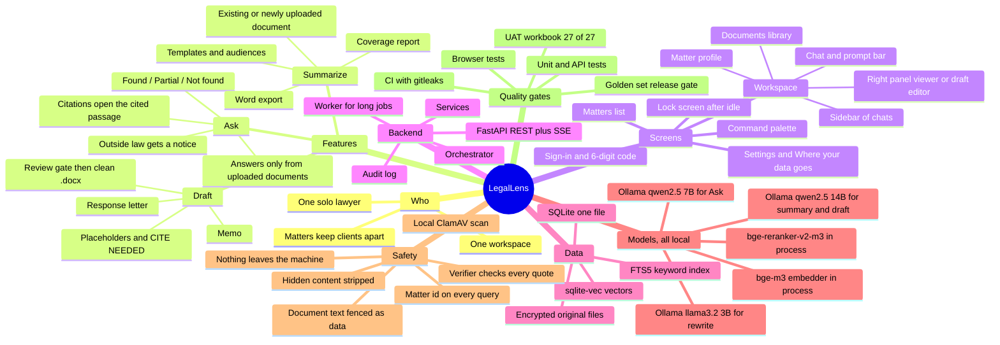

---

## 2. Layers and components

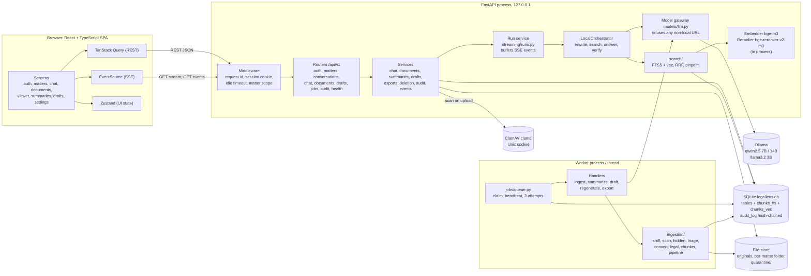

**Reading it.** The browser only ever talks to FastAPI. Commands go over REST; streams (a chat turn, matter events) go over SSE. Long work is queued in the `jobs` table and the worker picks it up. The only model server is Ollama on localhost, reached through one gateway.

---

## 3. Data model (class diagram)

22 tables. Everything below `Matter` carries `matter_id`, and the session scope guard adds `WHERE matter_id = ?` to every query.

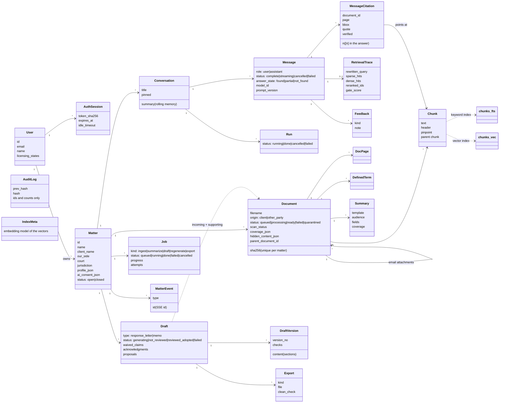

---

## 4. Sign-in and session

Dev mode accepts any password and any 6-digit code (`lawyer@legallens.local`).

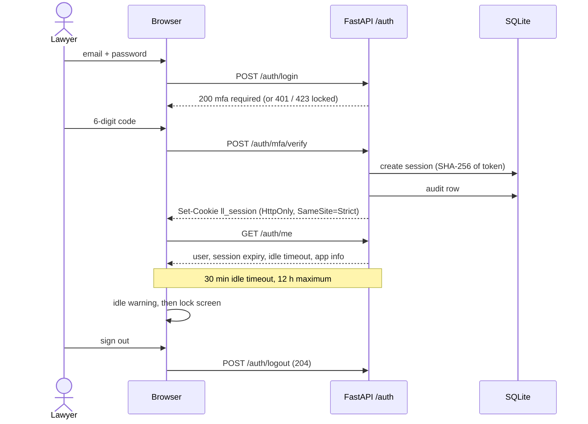

---

## 5. Upload and ingestion

The request only validates, scans, stores and queues. The worker does the rest.

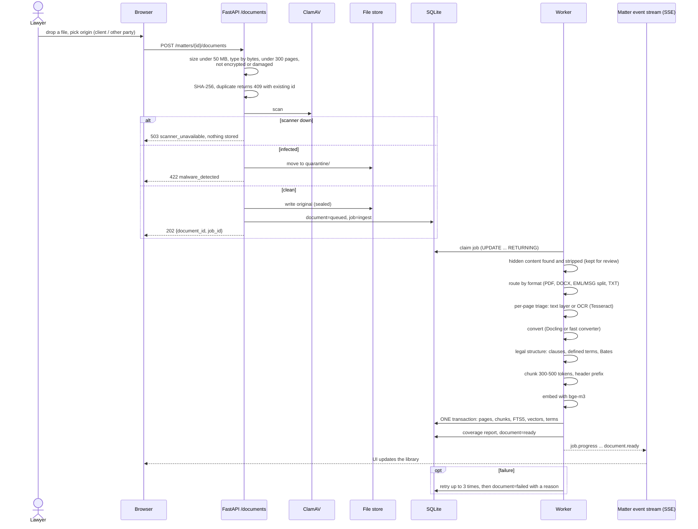

Delete is the mirror image: `DELETE /documents/{id}` removes the file, pages, chunks, FTS rows, vectors, terms, summaries and citations in one transaction (TC-24).

---

## 6. Ask: one chat turn

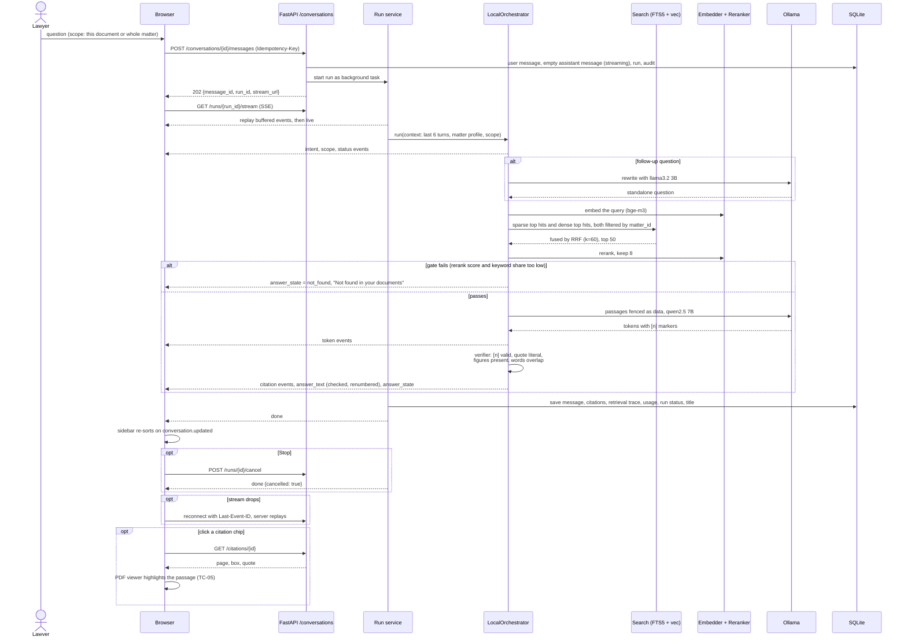

**Router (as built).** The prompt-bar mode if one is set; otherwise keywords (summarize, draft, reply, respond, memo); otherwise Ask; Clarify if the message has no content words or names an unknown document. The LLM intent router in the design was not built.

**Answer states:** `found` (all claims verified), `partial` (some citation unverified, or outside law noted, TC-08), `not_found` (gate refused or the model said not found, TC-07).

---

## 7. Summarize

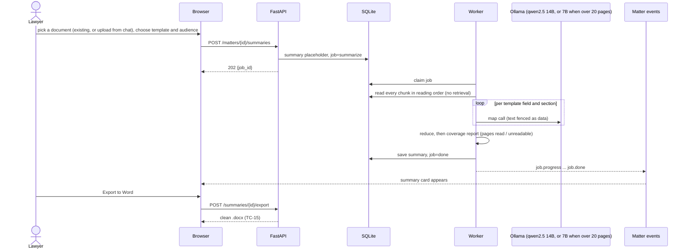

---

## 8. Draft, review and export

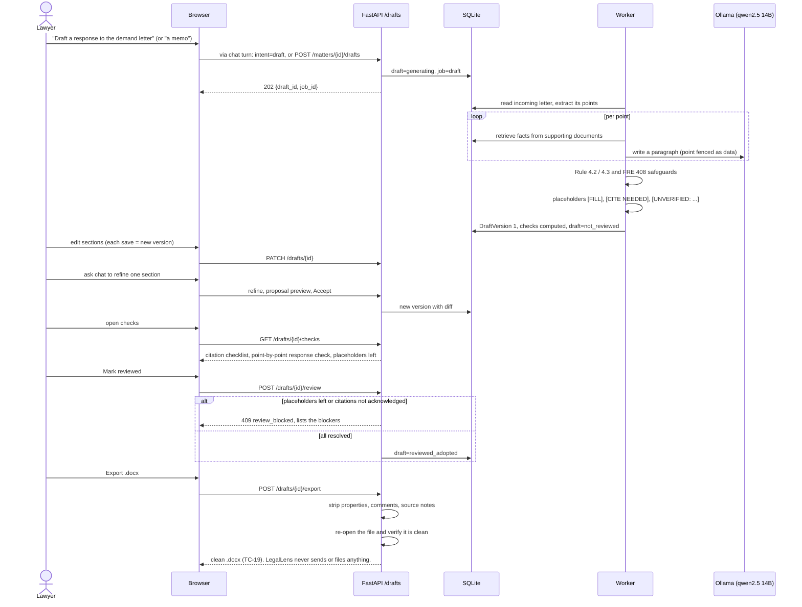

---

## 9. State machines

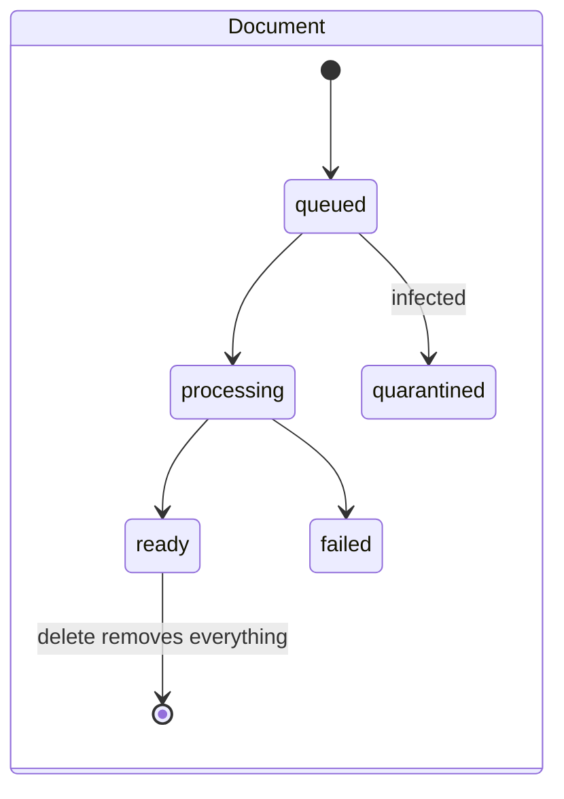

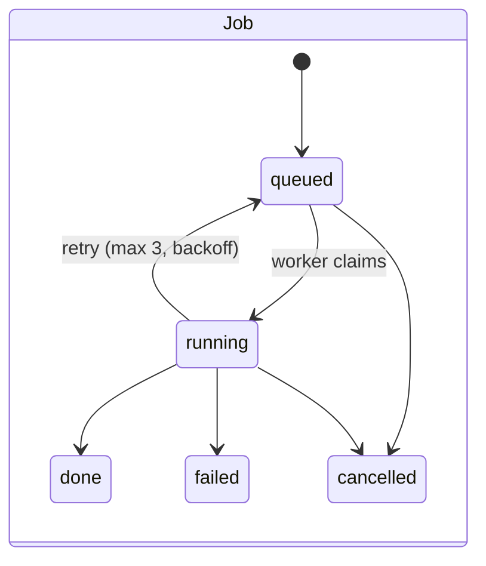

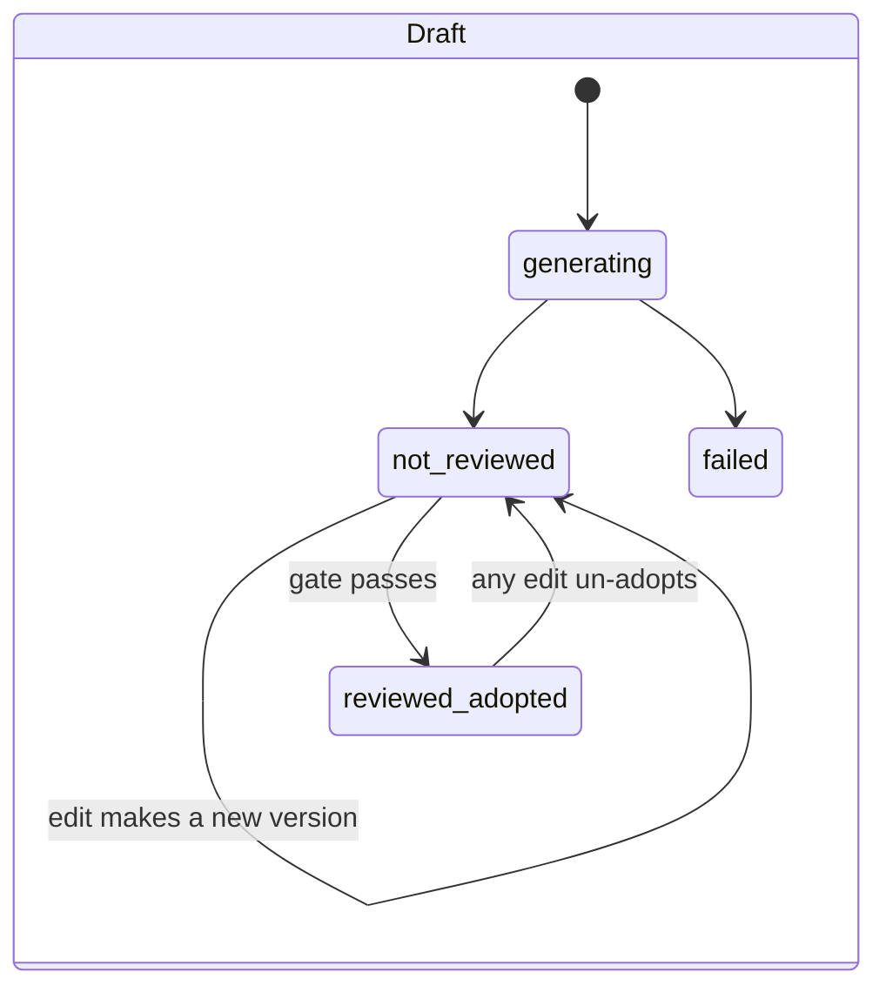

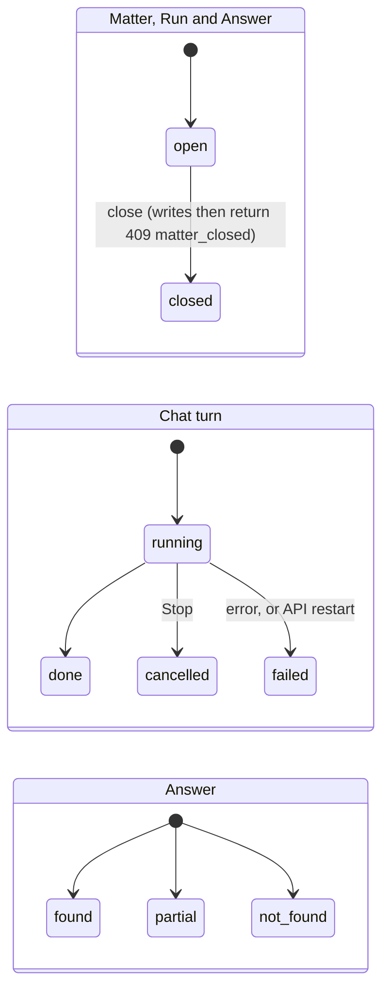

---

## 10. Deployment: what runs on the machine

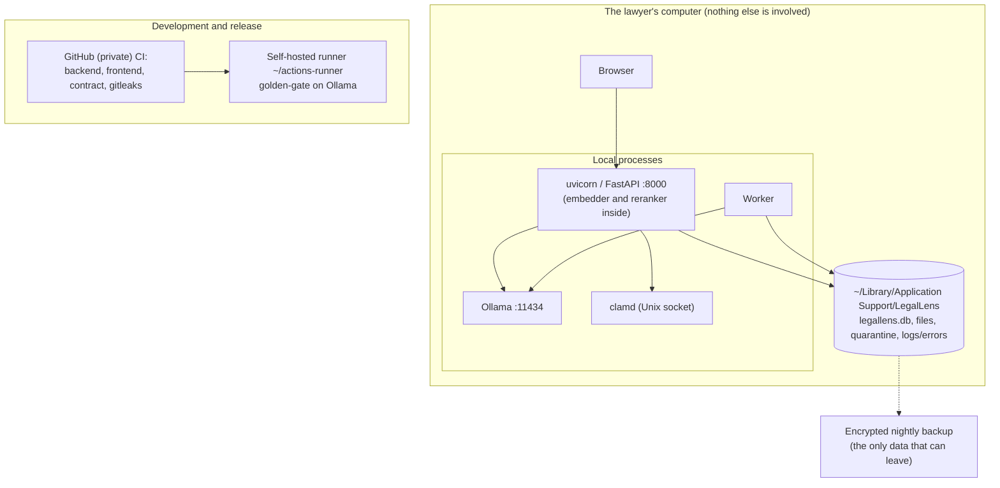

---

## 11. Human-test map: flow to UAT case

Tick these during the walkthrough. Each row says which diagram the case exercises and what to look for that automation cannot judge.

| Case | What you do | Diagram | What a human should judge |
|---|---|---|---|
| TC-01 | Sign in with the 6-digit code | 4 | Does the two-step flow feel clear? Any dead end? |
| TC-02 | Open a matter | 2 | Does the workspace open fast? |
| TC-03 | Upload three documents, set who each came from | 5 | Are progress steps understandable? Is the coverage report honest? |
| TC-04 | Ask a question | 6 | Is the answer right, and is every citation actually supported? |
| TC-05 | Open a citation | 6 | Is the highlight on the right sentence? |
| TC-06 | Follow-up question | 6 | Did it understand "and how much notice?" |
| TC-07 | Unanswerable question | 6 | Is "Not found" clear and helpful, with no invented answer? |
| TC-08 | Outside-law question | 6 | Is the notice clear that LegalLens has no outside law? |
| TC-09 to TC-13b | Rename, pin, search, feedback, ask again, delete and undo | 6 | Anything lost or surprising? |
| TC-14, TC-16 | Summarize existing or new document | 7 | Is the summary faithful? Does the coverage report match the pages? |
| TC-15 | Export summary to Word | 7 | Open in Word: formatting good, no metadata? |
| TC-17, TC-17b | Draft a memo (also in plain words) | 8 | Does auto mode choose a memo, not a letter? |
| TC-18 | Draft a response letter | 8 | Does each paragraph answer the right point, with sensible placeholders? |
| TC-19 | Resolve placeholders, acknowledge citations, adopt, export | 8, 9 | Does the gate block until it should? Is the .docx clean (File > Info in Word)? |
| TC-20 | Settings, About | 2, 10 | Every layer green, model named? |
| TC-21 | Where your data goes | 10 | Plain-language and true? |
| TC-22 | Command palette (⌘K) | 2 | Finds chats and documents? |
| TC-23 | Open another matter | 3 | Nothing from the first matter appears anywhere |
| TC-24 | Delete a document | 5 | Gone from the library, and a question about it no longer finds it |
| TC-25 | Phone-width layout | 2 | Ask and document list stay usable |

**Not covered by a numbered case (worth a manual pass):** lock screen after idle, closing a matter (writes blocked), Stop mid-answer, the scanner being down, a scanned PDF through OCR, and the known miss "Who is the judge in this case?" on a real opinion.
