# LegalLens: Technical Architecture

2026-10-07 · Shashank Panda

> Local copy, updated 2026-10-14. The master copy is the Claude Doc:
> [LegalLens: Technical Architecture](https://claude.ai/code/artifact/df0115b8-8e2f-4fb1-96f9-ebf980b458a2).
> Edits made there don't appear here until this file is exported again.

LegalLens runs entirely on the lawyer's own computer: a React app, a FastAPI backend, a hand-written orchestrator (LangChain was dropped in the build), local models, and one encrypted SQLite file that holds everything, including the search index. This v0.1 sets the stack and the designs for requests, retrieval, ingestion and data. The models were chosen provisionally on 2026-10-14 from a small comparison on sample documents (see Model selection and hardware); the full benchmark (DEF-01) and the hardware spec (DEF-02) are still to do.

The requirements are in the [BRD](https://claude.ai/code/artifact/22d52891-447c-45a0-a145-ab2cd51408e3). DEC, SUG, OPEN, DEF and RISK IDs refer to [IDEAS.md](../IDEAS.md). Each diagram is a frame of [LegalLens_Architecture_v0.2.excalidraw](LegalLens_Architecture_v0.2.excalidraw); open that file to see it full size. Each technology choice is marked **Decided** (agreed by the owner), **Assumed** (a working default to confirm) or **Open**.

**Status, 2026-10-10.** The backend is built to this design. It has 49 endpoints and passes 230 tests by default, plus 13 against the real engines and models, and 27 UI cases pass end to end on the real backend and local models. Since 2026-10-14 the orchestrator runs fully on this machine: bge-m3 embeddings and a bge reranker in-process, and Ollama models for the rewrite, the answer, summaries and drafts. The local engine is now the default; the stub stays for tests. Sign-in has a real mode (argon2id, TOTP, lockout), the database is encrypted with SQLCipher, stored files are sealed and backups have a tested restore; dev sign-in remains for development. Where the build changed the design, the section says so; the full record is in **Backend as built**, near the end.

**Frontend status, 2026-10-10.** The React frontend is built on mock data through its last phase, Phase 9: Ask, Documents, Summarize and Draft, plus Settings, system states and the session lock, on any screen from a phone up. It passes 59 unit tests and 51 browser tests with no accessibility violations. It reaches the backend only for the health check so far; the record is in **Frontend as built**, after the backend's.

**Closeout status, 2026-10-14.** The frontend is connected to the backend and the AI layer, and 27 UI cases pass end to end on the real backend with the local models (`test-evidence/LegalLens_E2E_Test_Results.xlsx`: ask with verified citations, not found, outside law, rename, pin, delete and undo, feedback, summarize an existing and a new document, a memo, a response letter through the export gate, health, isolation, document delete, phone width). The audit of every BRD requirement is [AUDIT_BRD_vs_BUILT.md](../AUDIT_BRD_vs_BUILT.md): 25 met, 1 partly, none unmet. Measured: a 50-page summary takes 204 s on the 7B (598 s on the 14B, so long documents use the 7B); the golden set scores 23/24 on both models with no invented answers. Decisions DEC-79 to DEC-89 are in IDEAS.md §2.13. Built since: HTTPS on localhost (`serve --https`), the incident plan (INCIDENT_PLAN.md), 35-day backup pruning, a release gate script (`scripts/release_gate.sh`), a feedback export and a model-written memo Statement of Facts (DEC-91, DEC-92); Ask runs on the 7B (DEC-90). Open: the good-law note in Ask, a CI service for the gate, and a lawyer's review of the golden set.

## Design constraints

Six rules from the BRD shape every part of this design.

- **Nothing leaves the machine.** Answering, embeddings, OCR, malware scanning, logs and tracing all run locally. The only data that leaves is an encrypted backup (DEC-08, DEC-11, DEC-56).
- **One model interface.** Every model call goes through a single gateway, so a model can be swapped and re-tested without touching the workflows (DEC-18).
- **Matter isolation in the backend.** Every search and cache lookup is filtered by `matter_id` inside SQL, not just hidden in the UI (DEC-53).
- **Grounded or silent.** Answers come only from retrieved passages. Weak evidence produces "Not found in your documents" (DEC-21, DEC-37).
- **Documents are data.** Uploaded text is fenced off in every prompt and can never act as an instruction (DEC-25, DEC-59).
- **Stream or run in the background.** Ask streams its answer. Summaries and drafts run as background jobs with progress (DEC-70). Targets: first words in 5 s or less, a full answer in 30 s or less, a 50-page summary in 5 min or less (DEC-14).

## System overview

Four local processes do all the work: the FastAPI app (which also runs the orchestrator), a background worker, the Ollama model server and the ClamAV scanner. The embedder and the reranker run inside the FastAPI and worker processes.

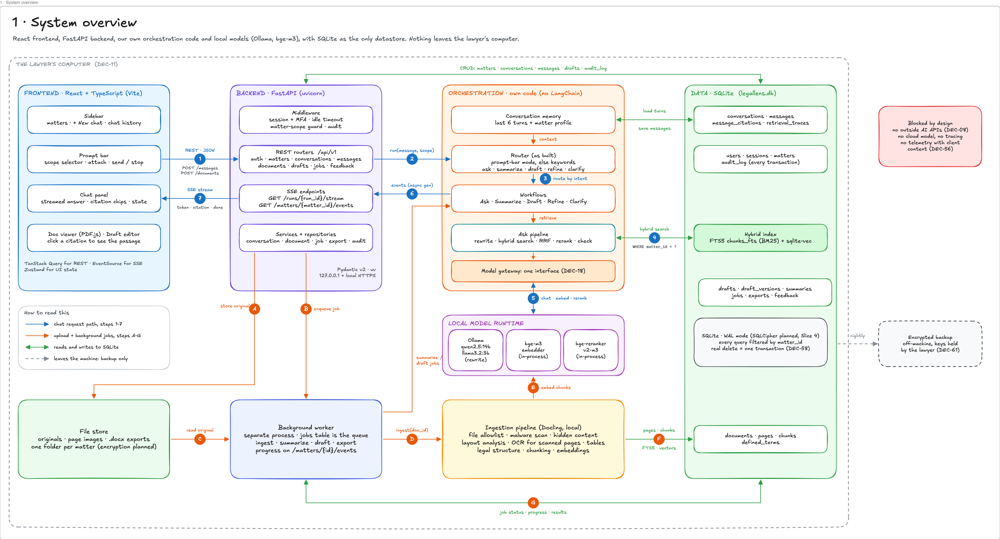

- **Frontend:** a React + TypeScript single-page app that FastAPI serves from the same origin. It uses REST for commands and SSE for streams.
- **Backend:** FastAPI routers behind middleware for session, MFA, idle timeout, matter scope and audit. Long work is queued, never run inside the request.
- **Orchestration:** our own code (`orchestrator/local`) for the question rewrite, retrieval, answer and checking. Summaries and drafts call the model inside their jobs. Every model call goes through the model gateway (`models/llm.py`). No LangChain.
- **Models:** Ollama serves the chat models. The bge-m3 embedder and the cross-encoder reranker run in-process.
- **Data:** SQLite holds every table, the FTS5 keyword index and the sqlite-vec vectors. Original files sit in an encrypted file store, one folder per matter.

The blue path (1–7) is a chat turn: prompt bar → REST → router → hybrid search → models → SSE → chat panel. The orange path (A–G) is an upload: store the original, enqueue a job, then the worker runs ingestion and writes pages, chunks and vectors. Only the nightly encrypted backup leaves the machine.

## Technology stack

Ten choices are decided, four are working defaults to confirm, and the models were chosen provisionally on 2026-10-14. The backend choices were confirmed with the backend plan and built on 2026-10-07.

| Layer | Choice | Status | Why |
| --- | --- | --- | --- |
| Frontend | React + TypeScript, built with Vite | Decided | DEC-16: PDF viewing with highlights, chat beside an editor, streaming |
| Frontend data | TanStack Query for REST, browser EventSource for SSE, Zustand for UI state | Assumed | Cached lists with retries; EventSource reconnects by itself |
| Viewer and editor | PDF.js with a highlight layer; TipTap (ProseMirror) for drafts | Assumed | A citation's page box becomes a highlight; Refine edits one section |
| Backend | Python 3.13 (uv-managed), FastAPI, uvicorn, Pydantic v2, sse-starlette, uv | Decided | DEC-16. Python 3.13 because the python.org 3.14 build can't load SQLite extensions |
| Orchestration | Hand-written async Python over an Ollama HTTP client (httpx); no LLM framework | Decided | Chosen 2026-10-05, reversed 2026-10-14: the pipeline is small and fixed, with a custom citation checker, so a framework added a layer and removed no code |
| Model runtime | Ollama on localhost | Assumed | Runs on macOS and on Windows or Linux GPUs; one local API for chat and embeddings |
| Chat model | qwen2.5:7b-instruct for Ask; qwen2.5:14b-instruct for summary and draft; llama3.2:3b for the question rewrite (provisional, 2026-10-15) | Open | DEF-01, DEC-65 |
| Embedding model | BAAI/bge-m3, 1024 dimensions, in-process through sentence-transformers (2026-10-13). The hashing embedder is for tests | Open | DEF-01 |
| Reranker | BAAI/bge-reranker-v2-m3 through sentence-transformers, in-process; keeps 8 of the top 50 | Assumed | Reads question and passage together to reorder the top 50 |
| Datastore | SQLite with SQLCipher (AES-256), WAL mode | Decided | Chosen 2026-10-05: one file to encrypt, back up and delete from. SQLCipher 4 is built (2026-10-14): `legallens db encrypt` converts a database, and stored files are sealed with AES-256-GCM |
| Hybrid search | FTS5 (BM25) + sqlite-vec, merged by reciprocal rank fusion | Decided | Chosen 2026-10-05: exact legal strings plus meaning, one SQL filter. sqlite-vec 0.1.9: partition key `matter_id`, metadata column `document_id` |
| Background jobs | A worker process that claims rows from a `jobs` table | Decided | No extra broker; queued jobs survive a restart. Claimed with one `UPDATE … RETURNING`; heartbeat, 3 attempts with backoff, stale-job recovery |
| Ingestion | Docling (layout, TableFormer, OCR through the Tesseract CLI), PyMuPDF, python-docx, extract-msg | Decided | Local; keeps reading order, tables and page boxes. PyMuPDF (AGPL-3.0) and extract-msg (GPL-3.0) are fine for one lawyer's use; revisit before LegalLens is offered to others (DEF-26) |
| Malware scan | ClamAV daemon, local | Decided | DEC-59 needs a scan that stays on the machine. clamd on a Unix socket only; uploads fail closed when it is down |
| Export | python-docx with properties, comments and source notes stripped | Decided | DEC-50 clean export. Each clean file is re-opened and checked before it is returned |
| Persistence code | SQLAlchemy 2 + Alembic migrations | Decided | Versioned schema changes. FTS5, vec0 and the audit triggers are raw SQL in the first migration |

## Frontend and API contract

The screen has five regions, and each one calls one or two of eight endpoint groups (A–H). Every path sits under `/api/v1`. The full endpoint list and the SSE event list are in [API reference](#api-reference) at the end of this file.

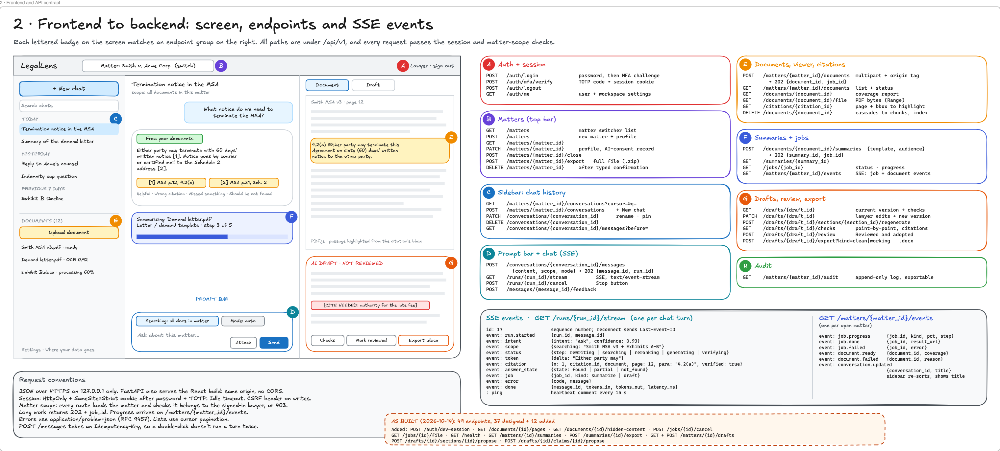

| Screen region | What the lawyer does there | Endpoint groups |
| --- | --- | --- |
| Top bar | Switch matter, sign out | A Auth, B Matters |
| Sidebar | Start a chat, reopen past chats grouped by date, search them, upload and track documents | C Chat history, E Documents |
| Chat panel | Read the streamed answer, its answer state and citation chips; give feedback; watch job cards | D Chat, F Jobs |
| Prompt bar | Set scope (this document or all documents in the matter), set mode (auto, ask, summarize, draft), attach, send, stop | D Chat, E Documents |
| Right panel | See the cited passage highlighted in the PDF; edit a draft, run its checks, mark it reviewed, export | E Citations, G Drafts |

Conventions every endpoint follows:

- JSON over HTTPS on 127.0.0.1. FastAPI serves the React build from the same origin, so there is no CORS. As built: plain HTTP on 127.0.0.1 in development; HTTPS and serving the React build come later, and the Vite dev server can proxy /api, so there is still no CORS.
- A session cookie (HttpOnly, SameSite=Strict) after password + TOTP, an idle timeout, and a CSRF header on writes. As built: cookie ll\_session, its token stored only as a SHA-256; 30-minute idle timeout and 12-hour maximum; dev mode accepts any password and any 6-digit code; the CSRF header comes with real sign-in.
- Every route loads the matter and checks that the signed-in lawyer owns it, or returns 403. A missing item returns 404, and a write to a closed matter returns 409 matter\_closed.
- Long work returns 202 with a `job_id`. Progress arrives on `GET /matters/{matter_id}/events`.
- Errors use `application/problem+json` (RFC 9457), each with a stable code and the request id. Lists use opaque cursor pagination. Every response carries X-Request-ID; the spec is at /openapi.json and Swagger UI at /docs.
- `POST /messages` takes an `Idempotency-Key` header, so a double-click never runs a turn twice. The same key with the same body returns the first response; with a different body, 409 idempotency\_conflict. One run at a time per chat (409 run\_in\_progress).

As built (frontend, 2026-10-07): the screens reach this API only through one `ApiClient` interface, implemented for now by a mock in the browser that sends the same events in the same order. The side panel's state lives in the URL. The mock was written before the backend and has drifted from it; see **Frontend as built**.

## One chat turn, end to end

A turn is two requests: a POST that saves the message, then a GET that streams the run as Server-Sent Events. The browser's EventSource can only send GET, and splitting the two lets a dropped stream resume.

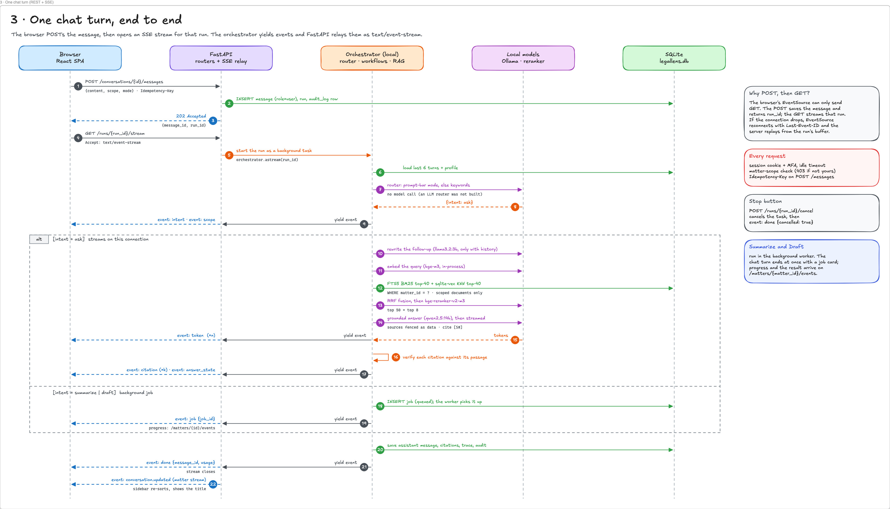

1. `POST /conversations/{id}/messages` saves the user message, an empty assistant message marked streaming and a run, writes an audit row, and starts the run as a background task. It returns `202 {message_id, run_id, stream_url}`.
2. `GET /runs/{run_id}/stream` opens the SSE stream: it replays the run's buffered events from the start (or from Last-Event-ID), then follows live.
3. The orchestrator loads the last 6 turns, the conversation's rolling summary and the matter profile, then calls the intent router.
4. **Ask:** rewrite → embed → hybrid search → fuse and rerank → generate. Tokens stream as they arrive; then each citation is verified and `citation` and `answer_state` events follow.
5. **Summarize or Draft:** the orchestrator inserts a job and sends a `job` event. Progress continues on the matter's event stream.
6. The assistant message, citations, retrieval trace and audit row are saved; `done` closes the stream. The sidebar re-sorts when `conversation.updated` arrives.

Each event carries a sequence `id`. If the connection drops, EventSource reconnects with `Last-Event-ID` and the server replays from that run's event buffer. A `: ping` comment every 15 s keeps the connection open. **Stop** calls `POST /runs/{run_id}/cancel`, which cancels the task and ends the stream with `done {cancelled: true}`.

As built, the run starts on the POST rather than when the stream opens (this differs from step 2 of Frame 3), so a late or dropped stream loses nothing. A finished run's buffer is kept for 10 minutes; after that the stream sends one `done` rebuilt from the stored message. A run interrupted by a restart is marked failed when the API starts. The orchestrator yields typed events; a run service, not the orchestrator, saves each citation as it arrives (the `citation` event carries the saved `citation_id`) and, at the end, the answer, the retrieval trace, usage, the run status and the chat's title.

## Orchestration: intent router and workflows

One LLM call per turn picks one of five workflows, and every workflow ends in the same output guard. The router is skipped when the lawyer picks a mode in the prompt bar.

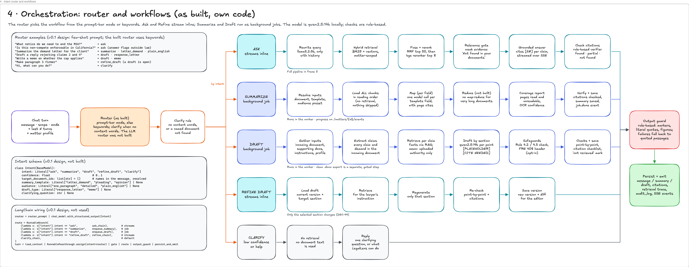

The router returns a fixed schema through `with_structured_output`, at temperature 0, with few-shot examples in its prompt. It reads only the message, the recent turns and the matter profile, never document text, so an injected instruction in a document cannot change the route.

```python
class Intent(BaseModel):
    intent: Literal["ask", "summarize", "draft", "refine_draft", "clarify"]
    confidence: float                       # 0..1
    target_document_ids: list[str] = []     # names in the message, resolved
    summary_template: Literal["letter_demand", "pleading", "opinion"] | None
    audience: Literal["one_paragraph", "detailed", "plain_english"] | None
    draft_type: Literal["response_letter", "memo"] | None
    clarifying_question: str | None
```

A confidence gate sends the turn to **Clarify** when confidence is below 0.70 or a named document isn't in the matter.

| Workflow | Runs as | What it does | BRD |
| --- | --- | --- | --- |
| Ask | Streams inline | The advanced RAG pipeline in the next section | DEC-35 to DEC-38 |
| Summarize | Background job | Reads every chunk in reading order (no retrieval), maps template fields per section, reduces, then adds the coverage report | DEC-40 to DEC-42 |
| Draft | Background job | Extracts each claim from the incoming document, retrieves facts per claim, drafts by section with placeholders, applies the Rule 4.2 / 4.3 and FRE 408 safeguards, runs the point-by-point and citation checks | DEC-43 to DEC-49 |
| Refine draft | Streams inline | Retrieves for the instruction, regenerates one section, re-checks it and saves a new version with a diff | DEC-44 |
| Clarify | Streams inline | Uses no document text; asks one question or explains what LegalLens can do | — |

The **output guard** removes or flags any claim without a supporting passage. It replaces authority that traces to no uploaded document with `[UNVERIFIED: …]` (DEC-48). The v0.1 design built the turn as one LangChain chain; the build did not use LangChain (see the as-built notes below).

As built, orchestration sits behind one interface, `Orchestrator.run(ctx)`, which yields typed events: intent, scope, status, token, citation, answer state, job, retrieval trace and usage. `RunContext` carries the message, mode, scope, options, the last 6 turns and the matter profile. `RunServices` gives matter-scoped calls back into the backend: search, start a summary, start a draft and refine a draft. A deterministic stub implements it today:

- **Router:** the prompt-bar mode if set; otherwise keywords (summarize, draft, reply, respond), else Ask; Clarify when the message has no content words or names no document it can find.
- **Ask:** follow-ups are rewritten by joining the previous question; then hybrid search, a gate on the best share of the question's words found in a keyword-matched passage (below 0.34 = "Not found in your documents"), quotes of the best sentence in up to 3 passages, each checked verbatim against its chunk.
- **Outside law:** questions about enforceability or what a state's law says are answered as partial, with the DEC-38 notice.
- Model id `stub-orchestrator` and prompt version `stub-0` are recorded on every message, so stub answers are never mistaken for model answers.

The local orchestrator replaced the stub by implementing the same interface; the API, the stored data and the tests stayed as they were.

**As built, 2026-10-14: the local orchestrator.** `LEGALLENS_ORCHESTRATOR=local` selects `LocalOrchestrator`, which extends the stub and replaces its model steps. Everything runs through one async client (`models/llm.py`, `httpx`) to Ollama on 127.0.0.1, and the client refuses any other URL (DEC-08). The owner's rule that nothing leaves the machine replaced the first plan's split between Haiku, Sonnet and Opus: there is no cloud model and no LangChain.

| Step | Model | Setting and notes |
| --- | --- | --- |
| Rewrite a follow-up | llama3.2:3b | `llm_rewrite_model`. Skipped when there is no history; a rewrite that answers instead of asking is rejected |
| Answer (Ask) | qwen2.5:7b-instruct | `llm_answer_model`. Prompt `ask-local-1` |
| Summary fields | qwen2.5:14b-instruct | `llm_summary_model`. One call per template field, inside the summarize job. Prompt `summary-local-1` |
| Draft paragraphs | qwen2.5:14b-instruct | `llm_draft_model`. One call per point of the incoming letter, inside the draft job, outside the write transaction. Prompt `draft-local-1` |

- **Router unchanged.** It is still the stub's mode-or-keyword router. The LLM intent router and its 0.70 confidence floor were not built.
- **Checking is rule-based.** One verifier (`orchestrator/local/text.py`) requires that each `[n]` marker points at a passage, each quote is literal in it (curly quotes and ellipses are normalised), every figure appears in a cited passage and each claim shares words with its passage. Otherwise the answer is marked partial, or falls back to quoted passages. A model's "Not found", even behind a marker, is a refusal.
- **Prompt safety.** Passages and the other side's points sit in delimited `<passage>` and `<point>` blocks that the system prompt calls data. Look-alike tags in document text are neutralised.
- **Failures.** Each one writes `logs/errors/<ErrorName>_<time>.log` with no client text. Only a refused connection is retried, because a timeout has already waited the full limit.
- **Known limit.** "Verified" means the quote is literal and the figures are in the passage. It does not mean the model understood the clause, so the review lock and `[CITE NEEDED]` keep a person in the loop.

## Ask: the advanced RAG pipeline

Ask rewrites the question using the conversation, searches by keyword and by meaning inside SQLite, keeps the best 8 passages, and answers only if they are strong enough. Every citation is then checked against its passage. Keyword search finds exact legal strings such as `4.2(b)(iii)`, a defined term or a Bates number. Vector search finds the same idea in different words ("cancel" for "terminate").

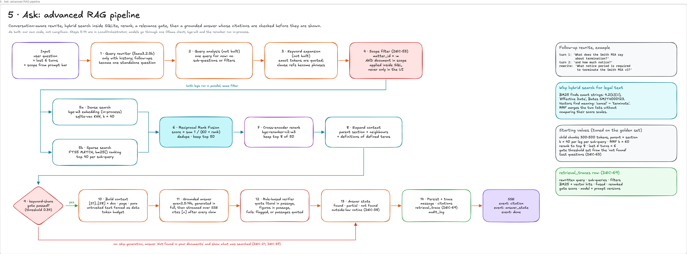

1. **Rewrite.** An LLM turns a follow-up into a standalone question. For example, "and how much notice?" after a question about the Smith MSA becomes "What notice period is required to terminate the Smith MSA v3?"
2. **Analyse.** A structured call splits the question into up to 3 sub-questions, extracts filters (document, section, date) and defined terms, and flags questions that need outside law.
3. **Scope.** `matter_id` and the documents in scope go into the SQL of both search legs (DEC-53).
4. **Search.** For each sub-question, sqlite-vec KNN and FTS5 BM25 each return their top 40, in parallel.
5. **Fuse and rerank.** Reciprocal rank fusion merges the lists into the top 50. A cross-encoder keeps the top 8, which are expanded with their parent section, neighbouring chunks and the definitions of any defined terms.
6. **Gate.** If the top rerank score is below the threshold, no answer is generated. The reply is "Not found in your documents", plus what was searched (DEC-21, DEC-37).
7. **Answer.** Passages go to the model as `[S1]`…`[S8]` with document, page and paragraph, fenced as untrusted data. The model streams an answer that cites `[S#]` after every claim and adds no outside law (DEC-06).
8. **Verify.** A local NLI model or LLM judge checks each claim against its cited passage. Failures are removed or flagged, and the answer is marked found, partial or not found (DEC-66).
9. **Record.** The message, citations and a retrieval trace are saved (DEC-69).

Starting values, each tuned on the golden set before release:

| Setting | Start | Tuned against |
| --- | --- | --- |
| Past turns sent to the router and rewriter | 6 | Follow-up questions |
| Sub-questions per question | up to 3 | Questions across several documents |
| Candidates per search leg, per sub-question | 40 | Recall |
| RRF constant k | 60 | Recall |
| Fused candidates sent to the reranker | 50 | Recall vs. rerank time |
| Passages sent to the model | 8 | Citation accuracy vs. context length |
| Relevance gate threshold | Set from data | Correct "not found" rate, without declining answerable questions (SUG-04) |
| Router confidence floor | 0.70 | How often Clarify fires |

As built on 2026-10-07, the data steps are real and the model steps are the stub's:

| Step | As built |
| --- | --- |
| 1 Rewrite | Stub: a follow-up ("and …", "what about …", or a pronoun with few words) is joined to the previous question |
| 2 Analyse | Not yet: one query, no sub-questions or filters |
| 3 Scope | Real: `matter_id` and the scoped document ids go into both legs' SQL; the "Searching: …" label is built from the documents |
| 4 Search | Real: FTS5 BM25 and sqlite-vec KNN, top 40 each. User text is always quoted in the MATCH query; clause references become phrases (`4.2(b)(iii)` → `"4 2 b iii"`) |
| 5 Fuse and rerank | Real fusion: RRF k = 60 to the top 50, then expansion with the parent section, neighbouring chunks and defined terms. No cross-encoder yet: the stub prefers keyword-matched passages |
| 6 Gate | Stub: the best share of the question's words in a keyword-matched passage, threshold 0.34 |
| 7 Answer | Stub: up to 3 passages, each quoted by its best sentence (rarer words weigh more), with a paragraph pinpoint |
| 8 Verify | Stub: each quote must appear verbatim in its chunk |
| 9 Record | Real: message, citations with boxes, retrieval trace (rewritten query, both legs' hits, fused and reranked ids, gate score), model and prompt version, tokens and latency |

**As built, 2026-10-14**, with the local models and the real embedder:

| Step | As built |
| --- | --- |
| 1 Rewrite | llama3.2:3b, only with history; the stub's join is the fallback |
| 2 Analyse | Still not built: one query |
| 4 Search | The query is embedded with bge-m3 (1024 dimensions, in-process); FTS5 and sqlite-vec as before |
| 5 Fuse and rerank | RRF to the top 50 (25 per leg), then bge-reranker-v2-m3 scores them and keeps 8 |
| 6 Gate | The reranker's top score decides: pass at 0.30, or at 0.05 when the keyword share is 0.60 or more (GATE_BENCHMARK.md). The keyword share alone when the reranker is off |
| 7 Answer | qwen2.5:7b-instruct, up to 8 passages, each claim cited `[n]` |
| 8 Verify | The rule-based verifier described under Orchestration, not an NLI model. Unverified citations are flagged and the answer is partial |
| 9 Record | As before, now with the model id, prompt version and token counts |

Tokens stream as the model writes them (first words in about 0.5 s once the model is loaded); an `answer_text` event then replaces the text with the checked version, renumbered and with unsupported parts removed. `index_meta` records which model wrote each matter's vectors: after a model change the dense leg is skipped, `/health` degrades and ingestion is refused until `legallens reindex` re-embeds the chunks.

## Ingestion: upload to searchable chunks

The upload request only validates, scans, stores and queues the file; the worker does everything else. Scanned pages are detected one page at a time, so a digital PDF with one faxed signature page still gets that page OCR'd.

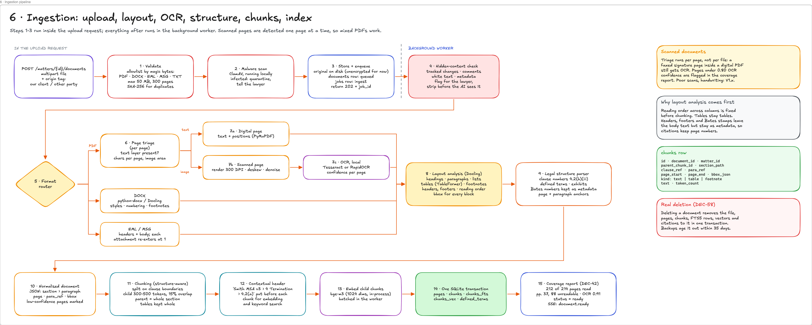

**In the upload request**

1. **Validate.** The file type is checked against an allowlist by its bytes, not its extension: PDF, DOCX, EML, MSG, TXT. The limits are 50 MB and 300 pages (DEC-14). A SHA-256 hash catches duplicates.
2. **Scan.** ClamAV runs locally. An infected file is quarantined, and the lawyer is told.
3. **Store and queue.** The original is written encrypted to the matter's folder, with a `documents` row (queued) and a `jobs` row (ingest). The request returns 202.

**In the worker**

4. **Hidden content.** Tracked changes, comments, white text and metadata are flagged for the lawyer and stripped before any model sees the text (DEC-59).
5. **Route by format.** DOCX goes to python-docx or Docling. An EML or MSG is split into headers and body, and each attachment re-enters at step 1.
6. **Triage PDF pages.** A page with a text layer goes to direct extraction with positions. A page whose body is only an image is OCR'd locally with Tesseract, with a confidence score per page. As built, a page needs OCR when its body (outside the top and bottom 7%) has under 20 characters, or an image covers 60% of it and the body has under 200 characters, so a faxed page with a stamped Bates number is still OCR'd. No deskew or denoise yet (poor scans are DEF-16).
7. **Layout analysis.** Docling's layout model finds headings, paragraphs, lists, tables (TableFormer), footnotes, headers and footers, and the reading order. Every block keeps its page box for highlighting.
8. **Legal structure.** A parser records clause numbers such as 4.2(b)(iii), defined terms, exhibits, and page and paragraph anchors. Bates stamps leave the body text and are kept as metadata (DEC-67).
9. **Chunk.** Child chunks of 300–500 tokens with 15% overlap are cut on clause boundaries. The parent chunk is the whole section, and a table is never split. Each chunk is prefixed with a header such as "Smith MSA v3 › 4 Termination › 4.2(a)" before it is embedded and indexed.
10. **Embed and write.** Child chunks are embedded in batches. One SQLite transaction writes pages, chunks, FTS5 rows, vectors and defined terms.
11. **Coverage report.** The report shows pages read and unreadable, plus OCR confidence (for example, "212 of 214 pages read; pp. 37 and 88 unreadable"). Pages below 0.80 OCR confidence are flagged. The document is marked ready, and a `document.ready` event goes to the browser (DEC-42).

**As built (2026-10-07)**

- **Upload checks, in order:** the Content-Length is checked before the body is read, and 50 MB again while the file is spooled and hashed; the type is checked by bytes (`%PDF-`; a ZIP holding `word/document.xml`; an OLE file with Outlook streams; email headers; otherwise UTF-8 text); PDFs over 300 pages, password-protected or damaged PDFs are refused; the same SHA-256 in the matter returns 409 with the existing document's id; clamd scans next.
- **Malware:** clamd unreachable = 503 `scanner_unavailable` and nothing is stored (fail closed). Infected = the file moves to `quarantine/<matter_id>/`, the document is recorded as quarantined, the upload returns 422 `malware_detected`, and the file is never read or served.
- **Sanitized copy (step 4):** PDF hidden spans are redacted in place, so page boxes still match the original; annotations, embedded files and identifying metadata are removed; an invisible text layer over a page-sized image (a scanner's OCR layer) is kept. DOCX deletions are dropped and insertions kept (the document as it now reads); comments, hidden, white and tiny runs and the properties are removed. What was found, with its text, is stored for the deliberate `GET /documents/{id}/hidden-content` step, which is audited.
- **Email (step 5):** the email itself is indexed as text with its headers; each attachment goes through steps 1–3 again as a child document with the same origin. A duplicate attachment links to the existing document; an unsupported one is listed in the email's metadata.
- **Converters:** Docling is the default. A fast converter (PyMuPDF text with positions, python-docx, Tesseract for image-only pages, no layout model) can be chosen in settings and runs the tests. Docling's list markers ("4.1", "(a)") are put back in front of the text.
- **Write (step 10):** one `BEGIN IMMEDIATE` transaction replaces everything made from the document, so re-ingesting is safe. A document with no readable text fails with a reason the lawyer can act on.
- **Progress:** the steps "Checking file", "Checking for hidden content", "Reading pages 34 of 120", "Finding structure" and "Indexing" arrive as `job.progress` events with the document id.

## Data model

One encrypted SQLite file, `legallens.db`, holds 22 tables in five areas: the 20 designed, plus runs and matter\_events added in the build. Every table that holds client data carries `matter_id`, so the scope guard on every database session adds `WHERE matter_id = ?` to every query.

As built, a query on a client-data table from a session with no matter scope is refused, a write into another matter is refused, and a session can't switch matters. Frame 7 shows the v0.1 design with 20 tables; the table below is as built.

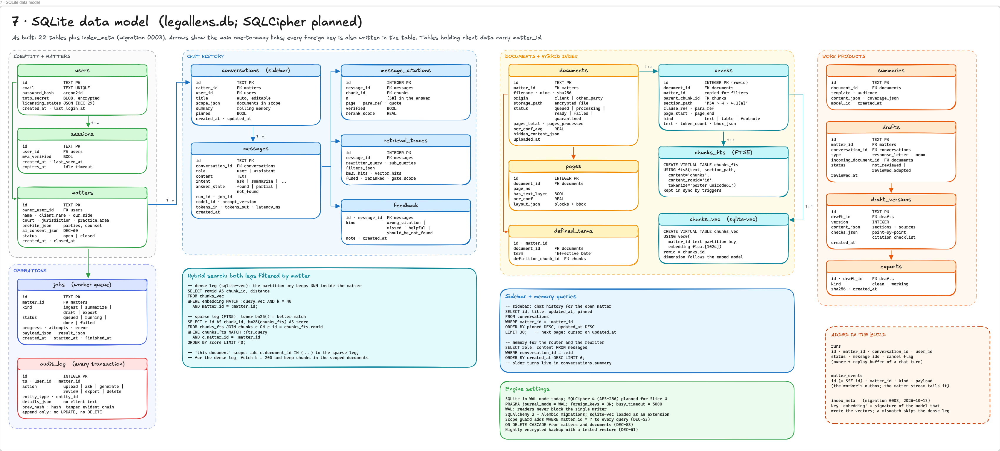

| Area | Tables | Notes |
| --- | --- | --- |
| Identity and matters | `users`, `sessions`, `matters` | Matter profile and AI-consent record as JSON (DEC-30, DEC-60) |
| Chat history | `conversations`, `messages`, `message_citations`, `retrieval_traces`, `feedback`, `runs` | The sidebar lists `conversations`; `conversations.summary` is the rolling memory; `runs` records each turn's owner and status, so a stream can be checked and replayed |
| Documents and hybrid index | `documents`, `pages`, `chunks`, `chunks_fts` (FTS5), `chunks_vec` (sqlite-vec), `defined_terms` | `chunks.id` is the rowid shared with both indexes; parent (section) chunks are stored but not indexed; each chunk keeps every paragraph's page, box, pinpoint and offsets |
| Work products | `summaries`, `drafts`, `draft_versions`, `exports` | Each draft edit is a new version; review status lives on `drafts` |
| Operations | `jobs`, `audit_log`, `matter_events` | `jobs` is the worker's queue; `audit_log` records every user transaction; `matter_events` is the outbox the matter SSE stream tails (its id is the SSE id), pruned after 7 days |

Both search legs filter by matter inside SQL:

```sql
-- dense leg: the partition key keeps the KNN search inside the matter
SELECT rowid AS chunk_id, distance FROM chunks_vec
WHERE embedding MATCH :query_vec AND k = 40 AND matter_id = :matter_id
  AND document_id IN (:doc_1, :doc_2)   -- only for a "This document" scope
ORDER BY distance;

-- sparse leg: a lower bm25() score is a better match
SELECT c.id AS chunk_id, bm25(chunks_fts) AS score
FROM chunks_fts JOIN chunks c ON c.id = chunks_fts.rowid
WHERE chunks_fts MATCH :fts_query AND c.matter_id = :matter_id
  AND c.document_id IN (:doc_1, :doc_2) -- only for a "This document" scope
ORDER BY score LIMIT 40;
```

Engine settings:

- SQLCipher 4 (AES-256), with the key held in the OS keychain. Not on yet: the build runs on plain SQLite in the OS app-data folder until Slice 4.
- `journal_mode = WAL`, `foreign_keys = ON`, `busy_timeout = 5000`, `synchronous = NORMAL`. With WAL, readers never block the single writer. Writes start with `BEGIN IMMEDIATE`, so the API and the worker wait for each other instead of failing with SQLITE\_BUSY.
- FTS5 stays in sync with `chunks` through triggers, which skip parent (section) rows. sqlite-vec is loaded as a run-time extension on every connection, and a trigger deletes a chunk's vector with it, including on cascades.
- `chunks_vec` uses cosine distance. Its vector size is fixed when the database is created (1024 by default); a different embedding model means recreating `chunks_vec` and re-embedding.
- `audit_log` is append-only (triggers refuse UPDATE and DELETE) and hash-chained (`prev_hash`, `hash`), and it never stores client text: details hold IDs, counts and enums only.
- Deleting a document removes its file, pages, chunks, FTS5 rows, vectors, defined terms, summaries and the citations to it in one transaction (DEC-58). Its email attachments go with it. Drafts stay, but lose their links to it.
- Migrations: SQLAlchemy 2 + Alembic. `chunks_fts`, `chunks_vec` and the audit triggers are raw SQL in the first migration.

## Security and confidentiality controls

Each BRD security requirement maps to a control in a named layer, and each control has an automated test before Slice 4 closes.

| Threat | Control | Source |
| --- | --- | --- |
| Client data reaches an outside service | Ollama, the API and every model bound to 127.0.0.1. LangSmith tracing off and no content in crash reports. A test fails if the AI layer opens an outbound connection | DEC-08, DEC-56 |
| One client's content in another client's answer | `matter_id` in every SQL query and cache key. The repository layer refuses a query without it. Cross-matter leak tests from Slice 1 | DEC-53, RISK-04 |
| Someone else signs in | Password (argon2id) + TOTP, idle timeout, HttpOnly SameSite=Strict cookie, CSRF header | DEC-54 |
| A stolen disk or backup | SQLCipher for the database, AES-256 for files, backups encrypted under keys the lawyer holds | DEC-57, DEC-61, RISK-13 |
| A malicious upload | Allowlist by file bytes, local ClamAV scan, quarantine | DEC-59 |
| An injected instruction in a document | Hidden content stripped. Document text fenced as data in every prompt. The router never reads documents. Output guard. Injection traps in the golden set | DEC-25, DEC-59, RISK-07 |
| Invented or unverified authority | No authority from model memory, `[UNVERIFIED: …]` markers, citation checklist before export | DEC-48, DEC-49, RISK-01 |
| Metadata or work product in a sent letter | Clean .docx with properties, comments and source notes removed. Export blocked while placeholders remain. Every export checked automatically | DEC-50, RISK-03 |
| Logs become an unprotected copy | No client text in application logs. Audit log and traces stay inside the encrypted database | DEC-68, RISK-12 |
| A deleted document lives on | One transaction removes file, chunks, FTS5 rows and vectors. Backups age it out within 35 days | DEC-58, DEC-13 |
| Client files synced to a cloud drive | Data lives in the OS app-data folder (owner-only), never in the project folder, which may sit in a synced Desktop or Documents folder. LEGALLENS\_DATA\_DIR must never point at a synced folder | DEC-08, DEC-56 |
| A framework or library exports or logs client text | FastAPI's OpenTelemetry hooks off. Logging is an allowlist: LegalLens loggers at INFO, third-party loggers held at WARNING. Access lines record the path without the query string, and errors log their type, never their message | DEC-56, DEC-68, RISK-12 |
| The malware scanner is not running | Uploads fail closed with 503 scanner\_unavailable; nothing is stored unscanned. /health reports the scanner's state | DEC-59 |

As built on 2026-10-07: matter isolation, real deletion, the audit chain, the upload allowlist, the local scan, hidden-content stripping, the clean export and the no-egress rule are built and tested (Backend as built, What the tests guard). Not yet: MFA and lockout, SQLCipher, encrypted files and backups, origin tags in prompts and the consent reminders.

## Observability, evaluation and the release gate

Any answer can be replayed from what is stored, and nothing ships if the golden-set scores drop (DEC-64, DEC-69).

- **Traces.** A LangChain callback handler writes each step (inputs, outputs, model, prompt version, latency) to SQLite. Retrieval details go to `retrieval_traces`. Hosted tracing (LangSmith) stays off.
- **Pinned versions.** Each message records `model_id` and `prompt_version`. Prompts are versioned files in the repository (RISK-18).
- **Compute.** Tokens and latency are recorded per message and per job, and summed per matter (DEC-71).
- **Audit.** `audit_log` records uploads, questions, generations, reviews, exports and deletions, and can be exported per matter (DEC-68).
- **Golden set.** A pytest harness runs 30–50 questions over public or synthetic documents, covering the DEC-63 categories, against the real local stack.

As built: `retrieval_traces` stores each answer's rewritten query, both legs' hits with scores, the fused and reranked chunk ids and the gate score. Every message records `model_id` and `prompt_version` (`stub-orchestrator`, `stub-0` for now), tokens and latency. `GET /matters/{id}` returns the matter's usage totals (tokens in, tokens out, compute time including jobs). The audit log exports per matter as JSONL and inside the matter .zip, with `chain_valid`. The local orchestrator writes these records itself, with no callback handler; the golden-set harness is still to come.

Release-gate targets, from SUG-04 and DEC-14:

| Metric | Target |
| --- | --- |
| Citation accuracy | 95% or higher |
| Authority the model introduced into a draft | 0 |
| Correct "not found", including outside-law questions | No drop from the last release |
| Response coverage: points addressed or flagged | No drop from the last release |
| Cross-matter leaks in tests | 0 |
| Exports with internal references or metadata | 0 |
| Ask: first words / full answer | 5 s / 30 s or less |

## Model selection and hardware

The chat, embedding and reranker models are picked in Slice 0 by golden-set score on the lawyer's own machine, not by reputation (DEC-65). The hardware spec follows from that run (DEF-02).

1. **Shortlist.** Choose open-weight models that Ollama can serve and whose licences allow commercial use (RISK-16): two or three instruction-tuned chat models in sizes that fit the machine's memory, two embedding models and two rerankers.
2. **Run.** Put each combination through the first golden set (DEC-20).
3. **Measure.** Record citation accuracy, the correct "not found" rate, time to first token, full-answer time, time for a 50-page summary, and ingestion pages per minute with OCR on.
4. **Pick.** Choose the smallest combination that meets the release-gate targets, and record it as a new DEC entry.

Starting shortlist, to check for licence and availability first: current Llama, Qwen, Mistral and Gemma instruction models for chat; bge-m3 and nomic-embed-text for embeddings; bge-reranker-v2-m3 for reranking. The embedding model sets the vector size in `chunks_vec`.

Within the $0–5k budget (DEC-11), the two platforms are an Apple-silicon Mac with high unified memory, or a PC with an NVIDIA GPU. Memory caps the largest model that fits. The minimum and recommended specs, with a page limit for each, are added here after the benchmark (RISK-15).

As built (2026-10-14): the embedder is BAAI/bge-m3 (1024 dimensions) and the reranker BAAI/bge-reranker-v2-m3, both run in-process from `<data dir>/models/hf` (`legallens models download --what embeddings`). The hashing embedder (`LEGALLENS_EMBEDDER=hash`) remains for the default tests. Docling's layout and TableFormer models (about 670 MB) run offline from the same data folder.

**Comparison, 2026-10-14** (`backend/tests/slow/`; results in `MODEL_COMPARISON.md` and `MODEL_COMPARISON_SUMMARY_DRAFT.md`). The same pipeline and the test embedder, with only the model changed, on the three sample documents and the demand letter, on an M3 Mac with 16 GB:

| Test | qwen2.5:7b-instruct | qwen2.5:14b-instruct |
| --- | --- | --- |
| Ask: correct answers, 11 questions | 10/11 | 11/11 |
| Ask: average time per question | 6.9 s | 24.4 s |
| Summary: fields right, 7 fields | 6/7 | 7/7 |
| Summary: time | 39 s | 218 s |
| Draft: points citing the MSA, 7 points | 7/7 | 7/7 |
| Draft: time | 13 s | 126 s |

The 7B's misses were a "Not found" behind a citation marker (now handled by the checker) and a threat sentence named as the sender. The 14B wrote real reasoning on the late-payment point (the MSA allows 30 days, the letter demands 14). It is a rough signal, not a benchmark: one small document set, 11 questions, and the hashing embedder for retrieval. The 14B needs about 9 GB of the 16 GB shared with bge-m3 and the reranker.

## Build slices

Each slice builds a thin piece of every layer and ends in a demo (DEC-17, DEC-72). The matter filter and leak tests arrive in Slice 1, because they are very hard to add later.

| Slice | Demo at the end (BRD) | Architecture built |
| --- | --- | --- |
| 0 | Upload one PDF, ask, get an answer from a local model | FastAPI and React shells, `POST /messages` + SSE stream, model gateway over Ollama, PyMuPDF text extraction, the benchmark harness |
| 1 | Retrieval with page citations and click-to-source | Core SQLite schema, chunking, FTS5 + sqlite-vec search, fusion and rerank, PDF.js highlights, repository matter filter + leak tests, first golden questions, a SQLCipher + sqlite-vec spike |
| 2 | Summarize a letter or demand, with a coverage report | `jobs` table + worker, the matter event stream, the Summarize workflow, the intent router (Ask or Summarize), Docling layout analysis |
| 3 | Draft a response letter, refine it, check it, export it clean | Draft and Refine workflows, the output guard, the citation checklist, `draft_versions`, the TipTap editor, review sign-off, clean .docx export |
| 4 | Security complete | MFA and sessions, SQLCipher on, encrypted files and backups with a restore test, the hash-chained audit log, real deletion, ClamAV, hidden-content checks, origin tags, the consent record, the no-egress test |
| 5 | MVP complete | Memo drafts, the other templates and presets, all-documents scope with query analysis, rolling-summary memory, close/export/delete matter, OCR for scanned pages, feedback, the release gate |

Backend status, 2026-10-07: the backend parts of Slices 1 to 5 are built (schema, hybrid search, matter filter and leak tests, jobs and the worker, the matter event stream, ingestion with Docling and OCR, summaries, drafts with checks, review and clean export, real deletion, the audit log, ClamAV, hidden content, origin tags, close, export and delete matter). Still to come: the full benchmark (Slice 0), MFA, SQLCipher, encrypted backups with a restore test and the release gate.

## Backend as built (2026-10-07)

The FastAPI backend was built to this design on 2026-10-07 with 111 tests. Integration Phase 1 (2026-10-10) added what the frontend needs, and it now passes 129 tests (127 by default, plus 2 against the real Docling and ClamAV), with 90% line coverage. The frontend is fully connected (integration Phases 0 to 5, 2026-10-11), and the app runs as one process: `legallens serve` with the built frontend and the worker in-process. The plan and its 80 tasks are in [BACKEND_TODO.md](../BACKEND_TODO.md); the run book is [backend/README.md](../backend/README.md); the API contract is [backend/openapi.json](../backend/openapi.json).

### What is real and what is a stand-in

| Part | As built | Later |
| --- | --- | --- |
| API | All 49 endpoints (37 designed, 6 added in the build, 6 added in integration Phase 1; see [API reference](#api-reference)), both SSE streams, problem+json errors, cursor pagination, Idempotency-Key | Serve the React build from the same origin; HTTPS on 127.0.0.1 |
| Sign-in | Real two-step contract, sessions (HttpOnly, SameSite=Strict cookie, token stored as SHA-256), 30 min idle timeout, 12 h maximum. Dev mode accepts any password and any 6-digit code | argon2id, TOTP enrolment, lockout, CSRF header (DEC-54) |
| Matter isolation | Scope guard on every ORM query and write, matter filter inside both search legs, leak tests (DEC-53) | Extend leak tests to any model cache that is added |
| Uploads | Allowlist by bytes, 50 MB and 300-page limits, SHA-256 duplicates, local ClamAV scan that fails closed, quarantine | Encrypted file store (DEC-57) |
| Ingestion | Hidden-content detection and a sanitized copy, Docling layout + TableFormer + Tesseract OCR, email split with attachments, legal structure, chunking, FTS5 + sqlite-vec, coverage report | Poor scans and handwriting (DEF-16) |
| Embeddings | bge-m3 (1024 dimensions, in-process) by default; the hashing embedder for tests (`LEGALLENS_EMBEDDER=hash`). `index_meta` records which model wrote a matter's vectors: a mismatch skips the dense leg, degrades /health and refuses ingestion until `legallens reindex` | Trim the bge-m3 download; the full golden-set benchmark (DEF-01) |
| Hybrid search | FTS5 BM25 + sqlite-vec KNN (top 40 each), RRF k = 60 to the top 50, expansion with parent section, neighbours and definitions | Done 2026-10-13: bge-reranker-v2-m3 keeps 8 of the top 50 |
| Chat turn | `Orchestrator` interface; the run service persists messages, citations, traces, usage and titles; replay and cancel | Done 2026-10-14: the local orchestrator sits behind the same interface |
| Stub orchestrator | Keyword router; Ask quotes the best sentences of the top passages with paragraph pinpoints, verifies each quote against its chunk, answers "Not found in your documents" below the gate, flags outside-law questions; Summarize and Draft queue jobs; Refine rewrites one section | Query analysis, an LLM intent router, NLI verification |
| Summaries | The three templates and three audience presets, a job per summary, coverage attached; stub text = the best passages per field, or "Not found in this document" | Done 2026-10-14 per field; map-reduce for very long documents is not built |
| Drafts | Claim extraction, Rule 4.2 / 4.3 addressee, placeholders, authority detection, citation checklist, point-by-point check, versions with optimistic locking, review sign-off, clean and working .docx exports; stub text = quotes of each claim with placeholders | Done 2026-10-14 per point; model-written memos are not built |
| Audit | Append-only (triggers), hash-chained, details limited to IDs, counts and enums; JSONL export | Nothing pending; the matter .zip includes it |
| Data at rest | SQLite in WAL mode and plain files, in the OS app-data folder (owner-only) | SQLCipher, encrypted files and backups with a restore test (DEC-57, DEC-61) |

### Where the code and data live

| Process | Command | Does |
| --- | --- | --- |
| API | `uv run legallens serve` | FastAPI on 127.0.0.1:8000 only; runs chat turns as asyncio tasks |
| Worker | `uv run legallens worker` | Claims `jobs` rows one at a time: ingest, summarize, draft, regenerate, export |
| Both, for development | `uv run legallens dev` | API with auto-reload and an in-process worker thread |
| Malware scanner | `brew services start clamav` | clamd on a local Unix socket only, no TCP |

- **Code:** `LegalLens/backend/src/legallens/`: `api/v1` (routes A–H and Ops), `services`, `db` (models, engine, scope guard), `migrations` (Alembic, with FTS5, vec0 and the audit triggers as raw SQL), `ingestion`, `search`, `orchestrator` (interface, stub, `local/`), `models` (embedder, reranker, Ollama client), `drafting`, `jobs`, `streaming`, `samples` (synthetic documents and the dev seed).
- **Data:** the OS app-data folder, never the project folder: `~/Library/Application Support/LegalLens` on macOS, `%LOCALAPPDATA%\LegalLens` on Windows, `~/.local/share/legallens` on Linux. It holds `legallens.db`, `files/<matter_id>/`, `quarantine/`, `exports/`, `models/docling/`, `models/hf/` (the bge models) and `logs/errors/` (one file per failed model call, no client text). `LEGALLENS_DATA_DIR` overrides it.
- **Settings:** `LEGALLENS_*` environment variables or a `.env` file (`backend/.env.example` lists every one).
- **CLI:** `db upgrade`, `db reset`, `seed --with-documents`, `search`, `jobs run`, `audit verify`, `models download` (`--what embeddings` for bge-m3 and the reranker), `reindex`, `openapi`.

### Differences from this design

The build kept the design and settled these details. The seven frames were redrawn on 2026-10-14 to match the build (`LegalLens_Architecture_v0.2.excalidraw`, with the v0.1 images kept in `png/v0.1`). Parts of the design that were not built are labelled as such in frames 4 and 5; this list and the as-built notes are the full record of what changed.

| Area | Designed (v0.1) | As built |
| --- | --- | --- |
| Tables | 20 tables | 22: adds `runs` (a turn's owner, status and messages, so a stream can be checked and replayed) and `matter_events` (the outbox the worker writes and the matter SSE stream tails; its row id is the SSE id). Migration 0003 (2026-10-13) adds `index_meta`, a key/value table that records which embedding model wrote a matter's vectors |
| Matter column | On tables that hold client data | On every one of them, including `messages`, `message_citations`, `retrieval_traces`, `feedback`, `pages`, `summaries`, `draft_versions`, `exports` and `runs`, so the scope guard covers all of them |
| Extra columns | — | `users.name`; `messages.status`, `mode`, `outside_law`, `idempotency_key`, `request_hash`, `error_json`; `conversations.title_source`; `documents.size_bytes`, `scan_status`, `parent_document_id` (email attachments), `metadata_json` (email headers, Bates, converter), `error_json`, `ready_at`; `summaries.status`, `job_id`; `drafts.title`, `instructions`, `current_version`, `safeguards_json`, `acknowledgments_json`, `job_id`; `jobs.document_id`, `cancel_requested`, `heartbeat_at`, `available_at` |
| FTS5 columns | `text, section_path` | `text, header`; `header` = "Doc › section › clause". Triggers index child chunks only; parent (section) rows are never indexed |
| Vector filter | "This document" over-fetches k = 200 | `chunks_vec` has a `document_id` metadata column; `document_id IN (…)` filters inside the KNN query (sqlite-vec 0.1.9). Cosine distance |
| Vector deletion | One transaction removes vectors | A trigger on `chunks` deletes the vector, so a cascade from a document or a matter removes vectors too |
| Write transactions | WAL, one writer | Writes start with `BEGIN IMMEDIATE`; reads stay deferred. The API and the worker both write, and a deferred read-then-write fails at once with SQLITE\_BUSY |
| Chat run start | The stream starts the orchestrator | The POST starts the run; events are buffered with sequence ids, so a late or dropped stream replays from `Last-Event-ID`. A finished run's buffer is kept 10 minutes, then the stream rebuilds one `done` from the stored message |
| Pinpoints | Document, page, paragraph per chunk | Per paragraph: each chunk stores every paragraph's page, box, clause reference and character offsets, so a citation names the exact clause, e.g. 4.2(b)(i), and highlights only that paragraph |
| Chunk overlap | 15% | The tail sentences of the previous chunk (about 75 tokens), not whole paragraphs |
| Page triage | A page without a text layer is OCR'd | OCR when the body (outside the top and bottom 7%) has under 20 characters, or when an image covers 60% of the page and the body has under 200 characters: a faxed page with a stamped Bates number still gets OCR |
| OCR | Rendered at 300 DPI, deskewed, denoised; Tesseract or RapidOCR | Docling's OCR with the Tesseract CLI on image regions; per-page confidence from Docling's confidence report. No deskew or denoise (poor scans are DEF-16). The fast converter renders at 300 DPI and runs Tesseract itself |
| Docling list numbers | — | Docling moves "4.1" and "(a)" into a separate `marker`; the converter puts it back in front of the text, or the clause references would be lost |
| Hidden content | Flagged and stripped | Ingestion converts a sanitized copy: PDF hidden spans are redacted in place, annotations, embedded files and metadata removed; DOCX deletions dropped, insertions kept (the document as it now reads), comments, hidden, white and tiny runs and properties removed. The original file is never changed. An invisible text layer over a page-sized image (a scanner's OCR layer) is kept |
| Legal structure | Clause numbers, terms, exhibits, Bates | Also: (i) after (h) is a letter, (c) after (ii) is a letter; a numbered paragraph closes the previous numbered heading at its level; street addresses are never numbered headings; running headers and footers are found by repetition |
| Sentences | — | One abbreviation-aware splitter (v., Corp., Cir., U.S.C., F.3d and so on) keeps case citations whole for chunking, quoting and claim extraction |
| Citation checklist | Full text uploaded / only mentioned / not in documents / added by the lawyer | "Full text uploaded" only when a document's file name names the authority, or its opening names it and reads like an opinion or a statute. The matter's own caption ("Smith v. Acme Corp") is never listed. Untraced authority is wrapped as `[UNVERIFIED: …]` on every saved version |
| Point-by-point statuses | Addressed or missing | `addressed`, `flagged` (the section exists but still has placeholders) or `missing` |
| Clean export gate | No placeholders, every checklist row acknowledged | Also requires "Reviewed and adopted". Editing an adopted draft returns it to "not reviewed". Each clean file is re-opened and checked (no markers, no comments part, empty core and app properties) before it is returned |
| Folder layout | `repositories/` package | No repositories package: the scope guard works on the SQLAlchemy session and services use it directly. Migrations live inside the package |
| Endpoints | 37 | 49 (43 at build + 6 from integration Phase 1); every addition and every request and response body are in [API reference](#api-reference) |

### Measured on the build machine

An Apple-silicon Mac, with synthetic documents only and no model yet; the model's time comes on top once the Slice 0 benchmark picks one.

| Measure | Result | DEC-14 target |
| --- | --- | --- |
| Docling ingestion of a 200-page digital PDF | 105 s, about 114 pages a minute; 1,220 chunks; 200 of 200 pages read | 300 pages per document |
| Sample set: 7 documents including 2 OCR pages | About 14 s once the models are loaded | — |
| OCR confidence on clean typed scans | 0.94–0.96 | Flag below 0.80 |
| Upload request, 2 MB PDF with the ClamAV scan | 80 ms (clamd scan about 40 ms; one 10 s outlier while clamd reloaded its signatures) | — |
| Hybrid search over 1,220 chunks | p50 6 ms, p95 11 ms | — |
| Chat, first token over a live server (stub) | 48 ms | 5 s or less |
| Chat, full answer (stub, 25 ms per streamed word) | 1.9 s | 30 s or less |
| Tests | 203 passing by default (111 at build), plus 11 against the real engines and models; ruff and mypy clean | — |

**With the local models (2026-10-14, M3 Mac, 16 GB).** Ask averaged 24 s on the 14B (7 s on the 7B), a summary of the 1-page demand letter took 3.6 min and a draft 2.1 min on the 14B. The ingestion and search numbers above are unchanged. The DEC-14 targets are not yet met for first words (5 s) and were not measured for a 50-page summary.

### Build environment notes

- **Cloud-synced project folder.** The Desktop on the build Mac syncs to iCloud Drive, so runtime data in the project folder would upload client files to Apple (DEC-08). That is why data lives in the OS app-data folder, with permissions 700, and the Docling models moved there too.
- **Virtual environment.** iCloud re-marks files under `.venv` as hidden, and Python 3.13 skips hidden `.pth` files, which breaks the editable install. The environment lives in `backend/.venv.nosync` (iCloud skips `.nosync`), with `.venv` as a link to it.
- **Python.** The python.org Python 3.14 build can't load SQLite extensions. The uv-managed Python 3.13 can, and it is pinned (`>=3.13,<3.14`). The lockfile covers Apple-silicon Macs, Linux and Windows; Intel Macs are excluded because PyTorch (needed by Docling) has no wheels for them.
- **Versions at build time:** FastAPI 0.142, Starlette 1.7, SQLAlchemy 2.1, Pydantic 2.13, sse-starlette 3.5, sqlite-vec 0.1.9, Docling 2.134 with PyTorch 2.14, PyMuPDF 1.28, Tesseract 5.5, ClamAV 1.5.
- **Docling models** (layout and TableFormer, about 670 MB) are downloaded once with `legallens models download`. Ingestion then runs with Hugging Face offline.
- **ClamAV** runs as a login agent (`brew services start clamav`) on a Unix socket only, and its virus definitions update with `freshclam`. It stopped once overnight; uploads failed closed with 503 as designed. After a reboot, run `brew services restart clamav`.
- **No telemetry.** FastAPI 0.142 ships OpenTelemetry hooks whose log signal records exception messages. Every signal and the environment-driven exporter are off.
- **Logging is an allowlist.** sse-starlette logged every streamed chunk at DEBUG, answer text included; the log-hygiene test caught it. LegalLens loggers log at INFO, and known third-party loggers are held at WARNING even when the root logger is set to DEBUG. Access lines record the path without the query string.

### What the tests guard

| Rule | Test |
| --- | --- |
| Matter isolation (DEC-53, RISK-04) | Two matters with near-identical documents: no search, answer, citation, stream or vector crosses. The scope guard refuses an unscoped query, a write into another matter and a session switching matters, and cached statements never reuse a matter id. A second lawyer gets 403 on all 22 endpoints that touch the first lawyer's data |
| Nothing leaves the machine (DEC-56) | Every outbound socket is blocked during ingestion, chat and a summary; none is attempted |
| No client text in logs (DEC-68, RISK-12) | A canary string in a matter name, a document, a question and a search never appears in any log line, at DEBUG |
| Audit (DEC-68) | Each write route leaves exactly one audit row with the right action; the hash chain detects an edited row; UPDATE and DELETE are refused |
| Real deletion (DEC-58) | After deleting a document or a matter: no rows, no FTS5 rows, no vectors, no files, no citations |
| Hidden content (DEC-59, RISK-07) | The injected white-text instruction in the other side's Word file reaches no chunk, no index and no viewer page |
| Clean export (DEC-50, RISK-03) | The clean .docx has no markers, comments or document properties; it stays blocked until placeholders, acknowledgements and review are done |
| Citations (DEC-36, DEC-48, DEC-49) | Paragraph pinpoints (4.2(b), 7.1); the other side's case is "only mentioned" and wrapped `[UNVERIFIED: …]`; the uploaded opinion makes it "full text uploaded" |
| Contract | `openapi.json` is committed and a test fails when the API changes without it; every operation has an id and documents its errors |

## Frontend as built

The React frontend was built on mock data from 2026-10-06 to 2026-10-10, through Phase 9: Ask, Documents, Summarize and Draft work end to end in the browser, with Settings, system states and the session lock around them, from a 390 px phone to a 1920 px desktop. It passes 59 unit tests and 51 browser tests, and axe finds no WCAG 2.1 AA violations on any of 26 screens and dialogs. It reaches the backend only for `/health` so far; [INTEGRATION_TODO.md](../INTEGRATION_TODO.md) plans the rest. The task plan is [FRONTEND_TODO.md](../FRONTEND_TODO.md), whose §10 logs every change to the plan with its reason; the run book is [frontend/README.md](../frontend/README.md); screenshots of every screen are in `LegalLens/architecture/screens/`.

### What works

| Area | What the lawyer can do | BRD rules it carries |
| --- | --- | --- |
| Shell | Sign in with MFA, pick a matter, search with ⌘K, rename, pin or delete chats (with undo); press ? for every keyboard shortcut | DEC-53 |
| Ask | Streamed answers with status steps; citation chips with pinpoint labels (§4.2(a), ¶3) that open the passage highlighted; found, partial and not found; the outside-law notice; what was searched | DEC-21, DEC-22, DEC-36 to DEC-38 |
| Documents | Upload with checks in the browser (type by first bytes, 50 MB, SHA-256 duplicates); live ingestion steps; coverage report; hidden-content notice; deletion that lists what goes; uploads pause while the malware scanner is down | DEC-42, DEC-58, DEC-59 |
| Summarize | Three templates and three audiences; a background job; coverage banner; "Not found in this document" for gaps | DEC-40 to DEC-42 |
| Draft | Letter or memo; fill placeholders and resolve flags; refine a section through a diff; answer or set aside each claim; tick each authority; FRE 408 and reservation-of-rights switches; review and adopt; clean and working exports; versions with restore | DEC-43 to DEC-51 |
| System states | Banners when the AI engine, malware scanner, background worker or storage has a problem, most serious first; while the engine is down every AI action pauses with the reason and reading still works; a closed matter is read-only | Plan task FE-8.3 |
| Session lock | After 30 minutes idle, a one-minute countdown, then a lock that needs the password and the 6-digit code; nothing of the matter shows or is announced behind it, toasts included; a reload stays locked | DEC-54 |
| Settings | Profile, licensing states, security (two-step sign-in, automatic lock), keyboard shortcuts, and About with the state of every local component; "Where your data goes" | DEC-29, DEC-54, DEC-55 |
| First run | A three-step guide in a new matter (the matter, its documents, a first question) in place of the suggested questions, until it has a document and a chat or is hidden | Plan task FE-8.5 |
| Any screen size | Three panes from 1280 px; below that the side panel covers the conversation, and below 1024 px the sidebar is a drawer; phones work, with nothing scrolling sideways | Plan task FE-9.3 |
| Not built yet | A new-matter dialog and editing a matter, matter export and delete, a resizable panel, saving mock data across reloads, the feedback form, and model and prompt versions in About | Open tasks in FRONTEND\_TODO; most wait for integration |

### Screens

Four of the 25 screenshots in `LegalLens/architecture/screens/`; the README there lists them all, and `npm run screenshots` in `frontend/` takes them again.

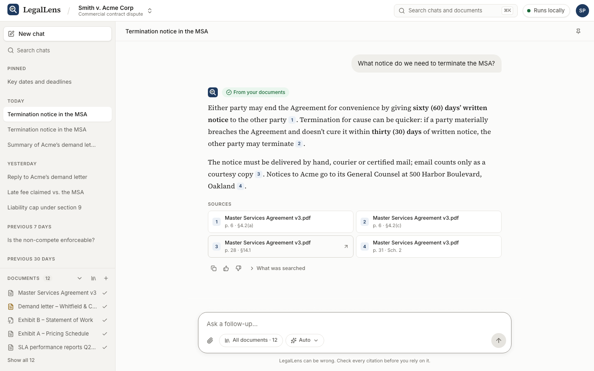

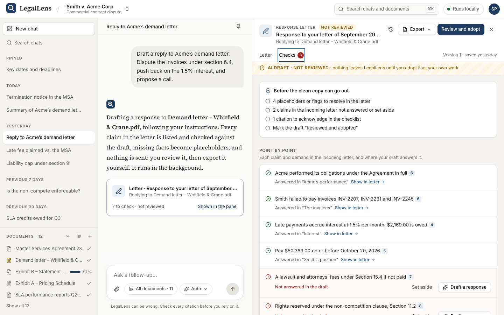

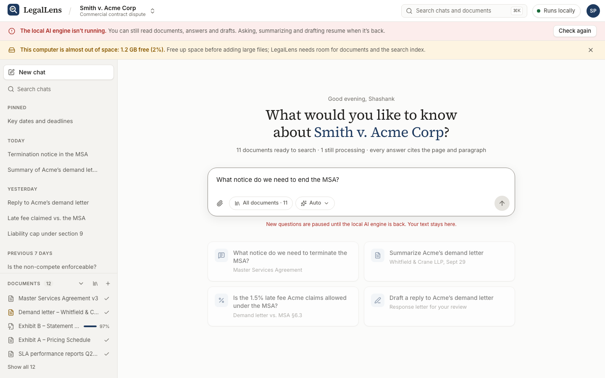

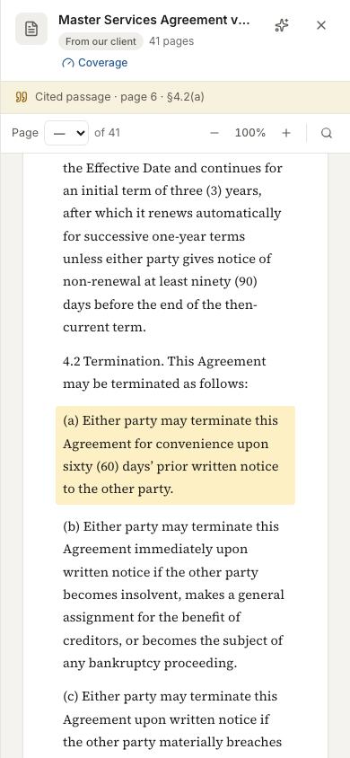

### How it is put together

- **Stack:** React 19.3, TypeScript 6 (strict), Vite 8.3, React Router 8.4, TanStack Query 5, Zustand 5, Tailwind CSS 4.3 with Radix UI 1.7, cmdk, Sonner and lucide-react. Inter and Source Serif 4 are bundled; there are no third-party network calls (DEC-56).
- **One seam to the backend.** Screens read and write only through hooks in `src/api/queries`, which call one `ApiClient` interface shaped like the API reference. `MockApiClient` implements it in the browser, and `HttpApiClient` talks to FastAPI; `VITE_API=http` picks the real one. In development Vite passes `/api` to the backend, so the browser sees one origin, and `scripts/dev.sh` starts both (integration Phase 0, 2026-10-10). So far the real client connects only `/health`; sign-in and data follow in integration Phase 2.
- **Real event shapes.** The mock streams the run events and the matter events (job progress, job done, document ready or failed) in the order the backend sends them, so the screens already handle streaming and background jobs.
- **The panel lives in the URL.** `?doc=…&page=…&cite=…`, `?summary=…` and `?draft=…` open the side panel, so refresh, links and Back keep what was open.
- **Draft rules in one module.** `src/lib/drafts.ts` holds the placeholder grammar, the citation checklist, the export gate and the word diff. The screen and the mock server both use it, so the screen never shows "ready" when the server would refuse.
- **Edits are queued.** Changes to a draft show at once and are saved one at a time, in order; review and export wait behind them, so the server judges the draft as the lawyer sees it.
- **System state from one place.** `useSystemStatus()` reads `GET /health` every 10 seconds. The banners, Settings › About and every AI action's pause all read it, so they never disagree; the component names are the backend's own (`orchestrator`, `worker`, `scanner`, `storage`).
- **The lock wraps every signed-in page.** A layout route, `SessionGuard`, watches for activity and shows the warning and then the lock. The lock is kept in `sessionStorage`, so a reload stays locked; the page beneath is made `inert` and hidden from screen readers, and toasts are switched off while locked.
- **A dev panel for failure states.** In development builds ⌘⇧D switches the mock's engine, worker, scanner or storage off, slows or fails requests, and shortens the idle lock to 30 seconds, so every degraded state can be seen and tested. It is not in the production build.
- **Layouts by width.** A media-query hook picks the layout: three panes from 1280 px; below that the side panel is a modal sheet over the conversation, and below 1024 px the sidebar is a drawer. Focus returns to whatever opened a panel.
- **Long lists render only what is in view.** Past 100 items the chat list and the library table are virtualised with TanStack Virtual (the table keeps its row count for screen readers), and ⌘K shows a shortlist. With 2,000 chats and 200 documents no action blocks the page for more than about 65 ms in the development build, down from up to 2.1 s.
- **Failures stay small.** Each panel has its own error boundary. A failed load says so, with Try again, instead of claiming the item was deleted, and data already on screen stays when a refresh fails.
- **Design tokens only.** Tailwind's default palette is switched off; every colour, radius and shadow comes from `src/styles/tokens.css` (light theme, warm neutral with ink navy).
- **Size:** 154 KB of JavaScript gzipped on first load (budget 250 KB). That includes the mock server and its seed data. An http-mode build still carries them too, because the seed modules run code when they load; integration task INT-5.1 removes them.

### Where it differs from the backend

The mock's contract was written from this document before the backend existed, so the two have drifted. [INTEGRATION_TODO.md](../INTEGRATION_TODO.md) §3 lists every difference; these change behaviour, and §4 there holds the decisions, all approved on 2026-10-10. Integration Phase 1 built the backend side of each on the same day. Frontend Phase 8 added the last three rows below, which the backend can't serve yet; INT-3.10, approved on 2026-10-10, adds the backend side in integration Phase 3.

| Topic | Frontend (mock) | Backend after integration Phase 1 | Still to do |
| --- | --- | --- | --- |
| Citation checklist | Computed in the browser; legal authorities only since 2026-10-10 | `GET /drafts/{id}/checks`, legal authorities only; ticking an unverified row is the lawyer's vouching | The screen reads the server's list and lets the tick vouch (INT-3.3, decision 1) |
| Unanswered claims | Block the clean copy unless set aside | Same rule, built in Phase 1: `waived_claims`, and the `unanswered_claims` blocker (decision 2) | The screen reads it (INT-3.3) |
| Review | Refused while anything else is open | Same rule, built in Phase 1: 409 `review_blocked` | None |
| Refining a section | A proposal, accepted or discarded | A preview endpoint, applied with `accept_proposal` (decision 3) | The screen accepts by preview id (INT-3.3) |
| Starting a draft | A dialog, or a chat turn | `POST /matters/{id}/drafts`, or a chat turn (decision 4) | The client calls it (INT-2.10) |
| Exports | Word-readable HTML `.doc`, built in the browser | Checked `.docx` for drafts and, since Phase 1, summaries (decision 5) | The screen downloads the server's file (INT-3.4) |
| Session timeout | A browser timer with the 30-minute default, then a lock that needs the password and the code | 401 session\_expired after 30 minutes idle; the timeout is in /auth/me | A 401 opens the lock, and the timeout comes from the server (INT-3.7) |
| Licensing states | Edited in Settings and kept in this browser | Stored on the user, with no endpoint to change them | An endpoint, and Settings saves to it (INT-3.10) |
| System health | Banners and pauses from /health, including storage space and the AI engine's state; model and prompt versions in About | /health has no storage component or versions, and the stub engine always reports ok | Storage and versions in /health (INT-3.10); an engine check arrives with the real orchestrator |

### Changes from the frontend plan

The full log is §10 of [FRONTEND_TODO.md](../FRONTEND_TODO.md); the ones that matter for architecture:

- The visible core was built ahead of phase order after the owner asked for a high-end look on 2026-10-06.
- Answers render through a small parser (paragraphs, lists, bold, `[n]`) that outputs text only; `react-markdown` is installed but unused, so there is no HTML path.
- The workspace grid fixes its row to the window height, so each panel scrolls on its own; the document viewer's page area is keyboard-focusable as a result.
- Every authority row needs its own tick and carries the later-history note, as DEC-49 says; a memo asks for the governing authority before drafting, as DEC-45 says. Both were caught by a cross-check against the BRD before sign-off.
- Phase 8 pulled in the session lock, the shortcuts sheet, the read-only banner and the dev panel from earlier phases. It read system state through the existing health call instead of editing the API layer frozen for integration, and keeps licensing states in the browser until the backend can save them.

### What the tests guard

| Suite | Tests | What a failure would mean |
| --- | --- | --- |
| Unit, Vitest | 59 in 14 files | Citation pinpoints, date grouping or upload checks broke; the answer engine, ingest simulator or summary scripts changed; a draft rule (placeholder grammar, checklist, export gate, diff, sentence removal) broke; the mock server stopped refusing review or the clean copy, or stopped un-adopting an edited draft; a banner stopped pausing what can't work; the idle timing changed, or a toast showed over the lock screen; a panel failure spread beyond its panel |
| Browser, Playwright + axe | 51 in 9 files | Sign-in, asking and opening a cited passage, upload edge cases, hidden content, deletion, summaries, the full draft-to-export flow, refine, starting a memo, the engine-offline pause, the idle lock, Settings, the first-run guide, a narrow-screen layout, keyboard-only use, large-data performance or the outage states stopped working, or any screen gained an accessibility violation |

Three bugs were caught by the draft browser flow and fixed before sign-off: a quick second edit was overwritten by the first edit's reply; removing a sentence cut text at "1.5%"; and a rewrite brought back a placeholder the lawyer had filled in.

Phase 8's screenshot review, at 1440 and 1024 px, caught six more faults, all fixed. Two mattered most: a toast naming a document showed over the lock screen, and screen readers could still read the page behind the lock.

Phase 9's audit found and fixed more. Modal menus hid the page from screen readers while it stayed focusable, and one label fell below 4.5:1 contrast. The search box had no focus ring, and focus was lost when a panel closed. A virtualised library showed no rows for 8.6 s, and a failed load was reported as a deleted chat. The screen-reader pass was an automated review of the accessibility tree, so a VoiceOver session is still to do.

## Open questions

Each question has a working default, so building can start now. Tick one off when it is confirmed, and record it in IDEAS.md.

- [ ] **Model runtime.** Answered 2026-10-13: Ollama on localhost, called directly over HTTP with no framework; the embedder and reranker run in-process. llama.cpp server and LM Studio were not tried.
- [x] **Layout and OCR.** Answered 2026-10-07: Docling with the Tesseract CLI, confirmed with the backend plan and built. Unstructured and PaddleOCR were the alternatives.
- [x] **Job queue.** Answered 2026-10-07: a plain `jobs` table claimed by the worker, built with heartbeat, retries and stale-job recovery.
- [ ] **Encrypted SQLite with vectors.** SQLCipher and the sqlite-vec extension must load together from Python. Half answered: sqlite-vec 0.1.9 loads in the uv-managed Python 3.13 (the python.org 3.14 build can't load extensions). SQLCipher with sqlite-vec is still the Slice 4 spike; fallback: SQLite on an encrypted volume.
- [ ] **Models.** Provisional, 2026-10-14: bge-m3, bge-reranker-v2-m3, llama3.2:3b, qwen2.5:14b-instruct, and the 7B for summaries over 20 pages. Golden set v1 (34 questions, GOLDEN_SET.md): both models 23/24 correct, 10/10 not found, 0 invented; a lawyer's review of the set (OPEN-01) is still to do.
- [ ] **Hardware.** Minimum and recommended specs, with page limits, after the benchmark (DEF-02). Docling ran at about 114 pages a minute on the build Mac.
- [ ] **IDEAS.md.** Add the two decisions from 2026-10-05 (SQLite as the only datastore with hybrid search; LangChain as the orchestrator, reversed on 2026-10-14 in favour of hand-written code over Ollama) and the backend decisions from 2026-10-06/07 (stub orchestrator, replaced on 2026-10-14 by the local one; Docling, Tesseract and ClamAV; dev sign-in until Slice 4; data in the OS app-data folder) as DEC entries, and point DEF-01 at them.
- [ ] **Licences.** PyMuPDF (AGPL-3.0) and extract-msg (GPL-3.0) are fine for one lawyer. Before LegalLens is offered to others (DEF-26): buy a licence, or swap to pypdfium2 and an olefile-based reader.
- [ ] **Outlook .msg files.** Parsing is built but untested, because there is no synthetic .msg generator. Test with a real or generated .msg file.
- [x] **Frontend and backend contract.** Answered 2026-10-10: all ten integration decisions in [INTEGRATION_TODO.md](../INTEGRATION_TODO.md) §4 approved, unchanged. The browser's citation checklist now lists legal authorities only, as the server's does, and the frontend's API layer is frozen for the integration work.
- [x] **Backend gaps from frontend Phase 8.** Settings and the banners need an endpoint to change licensing states, and a storage component and the model and prompt versions in /health. Answered 2026-10-10: the owner approved INT-3.10 in INTEGRATION\_TODO.md, which adds them in integration Phase 3.
---

## API reference

The backend exposes 49 REST endpoints in eight groups (A–H) plus Ops, and two SSE streams: the 37 designed, 6 added in the build on 2026-10-07 (marked **new**), and 6 added in integration Phase 1 on 2026-10-10 (marked Phase 1, like the events and bodies it enriched). Every path sits under `/api/v1`, and every route checks the session and the matter scope. Drafts and summaries usually start from the chat (the intent router queues the job); the endpoints below cover the rest. The machine-readable contract is [backend/openapi.json](../backend/openapi.json) (each operation's id is listed below), and Swagger UI runs at `/docs`.

### REST endpoints

| Group | Method | Path | Purpose | Operation id |
| --- | --- | --- | --- | --- |
| A Auth | POST | `/auth/login` | Check the password and start the MFA step; sets the session cookie, not yet usable | `login` |
| A Auth | POST | `/auth/mfa/verify` | Check the 6-digit code and finish signing in | `verifyMfa` |
| A Auth | POST | `/auth/logout` | End the session | `logout` |
| A Auth | GET | `/auth/me` | User, session and app settings, including licensing states | `getMe` |
| A Auth | POST | `/auth/dev-session` **new** | Dev mode only: both sign-in steps in one call, for Swagger UI and curl | `devSession` |
| B Matters | GET | `/matters?status=&cursor=&limit=` | Matter switcher list: open first, then most recently active | `listMatters` |
| B Matters | POST | `/matters` | Create a matter with its profile and AI-consent record | `createMatter` |
| B Matters | GET | `/matters/{matter_id}` | Matter profile, counts and usage totals | `getMatter` |
| B Matters | PATCH | `/matters/{matter_id}` | Edit the profile or the AI-consent record | `updateMatter` |
| B Matters | POST | `/matters/{matter_id}/close` | Make the matter read-only (repeating it is a no-op) | `closeMatter` |
| B Matters | POST | `/matters/{matter_id}/export` | Full matter file as a .zip; returns 202 + job; download from `/jobs/{job_id}/file` | `exportMatter` |
| B Matters | DELETE | `/matters/{matter_id}?confirm=<matter name>` | Delete everything, after the name is typed exactly | `deleteMatter` |
| C Chat history | GET | `/matters/{matter_id}/conversations?cursor=&q=&limit=` | Sidebar list: pinned first, then newest; search by title | `listConversations` |
| C Chat history | POST | `/matters/{matter_id}/conversations` | + New chat | `createConversation` |
| C Chat history | PATCH | `/conversations/{conversation_id}` | Rename or pin | `updateConversation` |
| C Chat history | DELETE | `/conversations/{conversation_id}` | Delete a chat (stops its run; drafts are kept, unlinked) | `deleteConversation` |
| C Chat history | GET | `/conversations/{conversation_id}/messages?before=&limit=` | Load a thread; older pages by cursor | `listMessages` |
| D Chat | POST | `/conversations/{conversation_id}/messages` | Send a message; starts the run; returns 202 | `sendMessage` |
| D Chat | GET | `/runs/{run_id}/stream` | SSE stream for that turn; `Last-Event-ID` or `?last_event_id=` replays | `streamRun` |
| D Chat | POST | `/runs/{run_id}/cancel` | Stop button | `cancelRun` |
| D Chat | POST | `/messages/{message_id}/feedback` | Helpful, wrong citation, missed something, should be not found | `sendFeedback` |
| E Documents | POST | `/matters/{matter_id}/documents` | Multipart upload + origin tag; returns 202 | `uploadDocument` |
| E Documents | GET | `/matters/{matter_id}/documents?status=&cursor=&limit=` | Documents with status | `listDocuments` |
| E Documents | GET | `/documents/{document_id}` | Status, coverage report and counts | `getDocument` |
| E Documents | GET | `/documents/{document_id}/file` | Original bytes for the viewer, with Range requests; never for a quarantined file | `getDocumentFile` |
| E Documents | GET | `/documents/{document_id}/pages?from=&limit=` **new** | Text blocks with boxes, page by page: the viewer for DOCX, email and text, and in-document search | `getDocumentPages` |
| E Documents | GET | `/documents/{document_id}/hidden-content` **new** | What was hidden in the file: a deliberate, audited step (DEC-59) | `getHiddenContent` |
| E Documents | GET | `/citations/{citation_id}` | Page and boxes to highlight | `getCitation` |
| E Documents | DELETE | `/documents/{document_id}?dry_run=` | Delete the file and everything made from it; `dry_run=true` lists what would go | `deleteDocument` |
| F Summaries and jobs | POST | `/documents/{document_id}/summaries` | Start a summary; returns 202 | `createSummary` |
| F Summaries and jobs | GET | `/matters/{matter_id}/summaries?document_id=&cursor=&limit=` **Phase 1** | The matter's summaries, newest first | `listSummaries` |
| F Summaries and jobs | GET | `/summaries/{summary_id}` | Summary with its coverage report | `getSummary` |
| F Summaries and jobs | POST | `/summaries/{summary_id}/export` **Phase 1** | .docx working copy with sources, stamped privileged | `exportSummary` |
| F Summaries and jobs | GET | `/jobs/{job_id}` | Status and progress | `getJob` |
| F Summaries and jobs | POST | `/jobs/{job_id}/cancel` **new** | Cancel: a queued job at once, a running one at its next step | `cancelJob` |
| F Summaries and jobs | GET | `/jobs/{job_id}/file` **new** | The file a finished export job produced (the matter .zip) | `getJobFile` |
| F Summaries and jobs | GET | `/matters/{matter_id}/events?since=` | SSE stream for job, document and chat events | `streamMatterEvents` |
| G Drafts | GET | `/matters/{matter_id}/drafts?cursor=&limit=` **Phase 1** | The matter's drafts, newest first | `listDrafts` |
| G Drafts | POST | `/matters/{matter_id}/drafts` **Phase 1** | Start a draft without a chat turn; returns 202 | `createDraft` |
| G Drafts | GET | `/drafts/{draft_id}?version=` | The current version, or an older one | `getDraft` |
| G Drafts | PATCH | `/drafts/{draft_id}` | Lawyer edits (a new version), restore a version, accept a preview, safeguards, checklist ticks, set-aside claims, named sources | `updateDraft` |
| G Drafts | POST | `/drafts/{draft_id}/sections/{section_id}/regenerate` | Regenerate one section as a job; returns 202 | `regenerateSection` |
| G Drafts | POST | `/drafts/{draft_id}/sections/{section_id}/propose` **Phase 1** | A rewrite as a preview with its diff; nothing changes until accepted | `proposeSectionRewrite` |
| G Drafts | POST | `/drafts/{draft_id}/claims/{claim_id}/propose` **Phase 1** | A new section answering a claim, as a preview | `proposeClaimResponse` |
| G Drafts | GET | `/drafts/{draft_id}/checks` | Point-by-point check, citation checklist and export blockers | `getDraftChecks` |
| G Drafts | POST | `/drafts/{draft_id}/review` | Mark the draft Reviewed and adopted; refused while anything else is open | `reviewDraft` |
| G Drafts | POST | `/drafts/{draft_id}/export?kind=clean\|working` | .docx export; clean is blocked until it is safe | `exportDraft` |
| H Audit | GET | `/matters/{matter_id}/audit?cursor=&action=&since=&limit=&format=` | Append-only audit log as JSON pages or a JSONL download | `getAuditLog` |
| Ops | GET | `/health` **new** | Each component's state; no sign-in, no client data | `getHealth` |

### Request and response bodies

One line per endpoint: the body or form it takes, what it returns, and its error codes. Type names are defined in Shared types below. Every error body is problem+json.

```text
A · Auth
POST   /auth/login               {email, password}        200 {mfa_required: true} + cookie (MFA pending) · 401 invalid_credentials
POST   /auth/mfa/verify          {code: 6 digits}         200 Me · 401 invalid_code | session_expired | not_authenticated
POST   /auth/logout                                       204, cookie cleared
GET    /auth/me                                           200 Me · 401 not_authenticated | session_expired | mfa_required
POST   /auth/dev-session (new)   {email?}                 200 Me; 404 outside dev mode or when env = prod

B · Matters
GET    /matters?status=open|closed|all (all)&cursor=&limit=1–200 (50)   200 Page[MatterSummary]
POST   /matters                  MatterCreate             201 Matter · 422 validation_error
GET    /matters/{matter_id}                               200 Matter
PATCH  /matters/{matter_id}      MatterUpdate             200 Matter · 409 matter_closed
POST   /matters/{matter_id}/close                         200 Matter (status closed, closed_at set)
POST   /matters/{matter_id}/export                        202 {job_id}; allowed on closed matters
DELETE /matters/{matter_id}?confirm=<name, exact>         204 · 422 confirmation_mismatch

C · Chat history
GET    /matters/{matter_id}/conversations?cursor=&q=(≤200)&limit=1–100 (30)   200 Page[Conversation]
POST   /matters/{matter_id}/conversations   {title?, scope?}   201 Conversation · 409 matter_closed · 422 invalid_scope
PATCH  /conversations/{conversation_id}     {title?, pinned?}  200 Conversation
DELETE /conversations/{conversation_id}                        204
GET    /conversations/{conversation_id}/messages?before=&limit=1–200 (50)
                                          200 Page[Message], oldest first within the page; next_cursor goes older

D · Chat
POST   /conversations/{conversation_id}/messages   header Idempotency-Key (required) + SendMessage
       202 {message_id, run_id, stream_url}
       409 run_in_progress | idempotency_conflict | matter_closed · 422 invalid_scope | invalid_option
       428 idempotency_key_required
GET    /runs/{run_id}/stream     text/event-stream; Last-Event-ID header or ?last_event_id=
POST   /runs/{run_id}/cancel     200 {run_id, status: running | done | cancelled | failed}; no-op if finished
POST   /messages/{message_id}/feedback   {kind: FeedbackKind, note? (≤2000)}
       200 {message_id, kind, note, updated_at}; resending replaces it · 422 not_assistant_message

E · Documents
POST   /matters/{matter_id}/documents   multipart: file, origin = client | other_party
       202 {document_id, job_id, status: "queued"}
       409 duplicate_document {existing_document_id} · 413 file_too_large | too_many_pages
       415 unsupported_type · 422 malware_detected {document_id} | unreadable_file · 503 scanner_unavailable
GET    /matters/{matter_id}/documents?status=&cursor=&limit=1–500 (100)   200 Page[Document]
GET    /documents/{document_id}                        200 DocumentDetail
GET    /documents/{document_id}/file                   200 or 206 (Range) original bytes, Cache-Control: private, no-store
                                                       409 document_quarantined
GET    /documents/{document_id}/pages?from=1&limit=1–50 (10) (new)   200 {document_id, pages_total, pages: [PageBlocks]}
GET    /documents/{document_id}/hidden-content (new)  200 {document_id, origin, notice, items: [HiddenItem]}; audited
GET    /citations/{citation_id}                        200 CitationLocation
DELETE /documents/{document_id}?dry_run=true|false (false)   200 DeletionReport (Phase 1: counts the chats that cite it)

F · Summaries and jobs
POST   /documents/{document_id}/summaries   {template, audience = detailed}   202 {summary_id, job_id} · 409 document_not_ready
GET    /matters/{matter_id}/summaries?document_id=&cursor=&limit=1–200 (50) (Phase 1)   200 Page[SummaryListItem]
GET    /summaries/{summary_id}              200 Summary
POST   /summaries/{summary_id}/export (Phase 1)   200 .docx attachment: summary-<document>.docx · 409 summary_not_ready
GET    /jobs/{job_id}                       200 Job
POST   /jobs/{job_id}/cancel (new)          200 Job · 409 job_not_cancellable
GET    /jobs/{job_id}/file (new)            200 application/zip · 409 job_not_done · 404 not_found (not an export job)
GET    /matters/{matter_id}/events?since=   text/event-stream; starts from now without since or Last-Event-ID

G · Drafts
GET    /matters/{matter_id}/drafts?cursor=&limit=1–200 (50) (Phase 1)   200 Page[DraftListItem]
POST   /matters/{matter_id}/drafts (Phase 1)   DraftCreate   202 {draft_id, job_id} · 409 matter_closed | document_not_ready
                                                          422 invalid_option
GET    /drafts/{draft_id}?version=          200 Draft (current or an older version)
PATCH  /drafts/{draft_id}                   DraftPatch   200 Draft · 409 version_conflict {current_version} | draft_not_ready
                                                         | proposal_stale · 404 not_found (preview gone)
                                                         422 unknown_section {section_ids} | unknown_claim {claim_ids}
                                                         | invalid_option (more than one of sections, restore, accept)
POST   /drafts/{draft_id}/sections/{section_id}/propose (Phase 1)   {instruction (1–2000)}   200 SectionProposal
                                                         409 draft_not_ready · 404 not_found
POST   /drafts/{draft_id}/claims/{claim_id}/propose (Phase 1)   200 ClaimProposal · 409 draft_not_ready · 404 not_found
POST   /drafts/{draft_id}/sections/{section_id}/regenerate   {instruction (1–2000)}   202 {job_id} · 409 draft_not_ready
GET    /drafts/{draft_id}/checks            200 DraftChecks
POST   /drafts/{draft_id}/review            {confirm: true}   200 Draft (reviewed_adopted, reviewed_at; watermark null)
                                            409 review_blocked {blockers} while anything else is open (Phase 1)
POST   /drafts/{draft_id}/export?kind=clean|working
       200 .docx attachment: response-letter-v2.docx, or ...-working-copy.docx
       409 export_blocked {blockers} | draft_not_ready · 500 export_verification_failed (never returned unchecked)

H · Audit
GET    /matters/{matter_id}/audit?cursor=<id>&action=&since=&limit=1–1000 (100)&format=json|jsonl
       200 {items: [AuditEntry], next_cursor, chain_valid}; jsonl = a download with X-Audit-Chain-Valid

Ops
GET    /health (new)   200 {status: ok | degraded, version, db, sqlite_vec, fts5, worker, scanner, embedder,
                            converter, orchestrator}; each component = {kind, ok, detail}
```

### Shared types

JSON is snake_case; timestamps are RFC 3339 in UTC (`2026-10-07T14:03:22.123456Z`); `?` marks an optional field; `|` lists the allowed values. Request bodies reject unknown fields. IDs are prefixed ULIDs (`mat_…`, `cnv_…`, `msg_…`, `run_…`, `doc_…`, `job_…`, `sum_…`, `drf_…`); citations and audit entries use integer ids. Boxes are `[x0, y0, x1, y1]` in PDF points from the top-left corner.

```python
Page[T]      = {items: [T], next_cursor: str?}                       # opaque cursor
Problem      = {type, title, status, detail, instance, code, request_id, errors?: [{loc, msg}], **extra}
ErrorInfo    = {code, message}

# A · Auth
Me           = {user: User, session: {expires_at, idle_timeout_s}, auth_mode: dev | real, app: AppInfo}
User         = {id, email, name, licensing_states: [str], created_at, last_login_at?}
AppInfo      = {version, orchestrator, embedder, converter, scanner, model_id?, prompt_version?}

# B · Matters (DEC-30, DEC-60)
MatterCreate = {name, client_name, our_side (≤60), court?, jurisdiction?, practice_area?, profile?: Profile, ai_consent?: AiConsent}
MatterUpdate = every MatterCreate field optional
Profile      = {parties: [Party], court_level?: federal | state, notes?}
Party        = {name, role: client | opposing | other, represented: bool, counsel?: {name, firm?, address?, email?}}
AiConsent    = {status: not_recorded | given | declined, recorded_on?: date, told_tool, told_data, told_risks: bool,
                notes?, consent_document_id?}
Matter       = {id, name, client_name, our_side, court?, jurisdiction?, practice_area?, profile, ai_consent,
                status: open | closed, counts: {documents, conversations},
                usage: {tokens_in, tokens_out, compute_ms}, created_at, closed_at?, last_activity_at}
MatterSummary = {id, name, client_name, status, document_count, last_activity_at,
                court?, practice_area?, opposing_party?, opposing_counsel?: {name, firm?}}   # the last four: Phase 1

# C, D · Chat
Scope        = {kind: all | documents, document_ids: [id]}           # "This document" = one id
Mode         = auto | ask | summarize | draft
Intent       = ask | summarize | draft | refine_draft | clarify
Conversation = {id, matter_id, title, pinned, scope, created_at, updated_at}   # title "New chat" until the first turn
SendMessage  = {content (1–8000), scope = {kind: all}, mode = auto, options?: {summary_template?, audience?,
                draft_type?: response_letter | memo, incoming_document_id?, supporting_document_ids?, draft_id?}}
Message      = {id, conversation_id, role: user | assistant, content, status: complete | streaming | cancelled | failed,
                mode?, intent?, answer_state?: found | partial | not_found, outside_law, scope_label?,
                citations: [Citation], searched?: Searched, run_id?, job_id?, job?: {kind, entity_id},
                model_id?, prompt_version?, tokens_in?, tokens_out?, latency_ms?, feedback?: FeedbackKind, created_at}
Searched     = {scope_label, rewritten_question, documents_searched, passages_reviewed, passages_used}   # Phase 1, DEC-22
Citation     = {id, n, document_id, document_name, page, para_ref?, quote, verified}
FeedbackKind = helpful | wrong_citation | missed_something | should_be_not_found

# E · Documents
Document     = {id, matter_id, filename, mime, size_bytes, sha256, origin: client | other_party,
                status: queued | processing | ready | failed | quarantined, scan_status: clean | infected | skipped,
                pages_total?, pages_processed, ocr_conf_avg?, hidden_content?: {kinds: [HiddenKind], count},
                parent_document_id?, error?: ErrorInfo, uploaded_at, ready_at?}
DocumentDetail = Document + {coverage?: Coverage, chunk_count, defined_term_count, job_id?}
HiddenKind   = tracked_changes | comments | hidden_text | white_text | tiny_text | metadata | annotations | embedded_files
HiddenItem   = {kind: HiddenKind, page?, location, text?}             # text up to 500 characters
Coverage     = {pages_total, pages_read, pages_unreadable: [int], ocr_pages: [int],
                low_confidence_pages: [{page, ocr_conf}], text}      # "2 of 2 pages read; OCR on p. 2"
PageBlocks   = {page_no, width, height, has_text_layer, ocr_conf?, blocks: [{id, kind, text, bbox, section_path?, ref?}]}
                                                                       # ref = the paragraph's pinpoint (Phase 1)
CitationLocation = {id, document_id, document_name, page, para_ref?, quote, bbox?, boxes: [Box], page_width?,
                page_height?, verified}
Box          = {page, bbox, ref, start, end}                           # ref = the paragraph's pinpoint
DeletionReport = {document_id, dry_run, removed: {documents, pages, chunks, fts_rows, vectors, citations,
                conversations, defined_terms, summaries, file_bytes}}   # conversations: Phase 1

# F · Summaries and jobs
Job          = {id, matter_id, kind: ingest | summarize | draft | regenerate | export,
                status: queued | running | done | failed | cancelled, progress (0–100), step?, attempts,
                document_id?, error?: ErrorInfo, result?: {kind, id, url}, created_at, started_at?, finished_at?}
SummaryRequest = {template: letter_demand | pleading | opinion, audience: one_paragraph | detailed | plain_english}
SummaryListItem = {id, document_id, document_name, template, audience, status, conversation_id?, created_at}   # Phase 1
Summary      = {id, matter_id, document_id, document_name?, conversation_id?, template, audience,
                status: pending | ready | failed, job_id?,
                sections: [{field, title, found, content, citations: [InlineCitation]}], coverage?,
                model_id?, prompt_version?, error?, created_at}
InlineCitation = {n, chunk_id, document_id, document_name?, page, para_ref?, quote, bbox?: [Box]}

# G · Drafts (DEC-43 to DEC-51)
Draft        = {id, matter_id, conversation_id?, type: response_letter | memo, title, incoming_document_id?,
                supporting_document_ids, status: generating | not_reviewed | reviewed_adopted | failed,
                watermark?: "AI draft · not reviewed", reviewed_at?, version, is_current,
                sections: [Section], placeholders: [Placeholder], safeguards: Safeguards,
                versions: [{version, source: ai | lawyer | regenerate | restore, label, created_at}],
                last_diff?: {section_id, before, after, ops: [{op: equal | insert | delete, text}]},
                claims: [Claim], acknowledged: [checklist item id], added_authorities: [str], date_line?,
                memo_header?: {to?, from?, re?}, model_id?, prompt_version?, created_at, updated_at}
                # label, claims, acknowledged, added_authorities, date_line, memo_header, model_id, prompt_version: Phase 1
Section      = {id, heading, content, citations: [InlineCitation], origin: ai | lawyer, claim_ids: [str],
                kind?, show_heading}   # kind: addressee | re | intro | point | closing | memo_header | …; Phase 1
Claim        = {id, text, source?: InlineCitation, status: addressed | flagged | missing | waived, addressed_by?,
                waived}   # Phase 1, DEC-47
DraftListItem = {id, type, title, status, incoming_document_id?, incoming_document_name?, conversation_id?, version,
                reviewed_at?, created_at, updated_at}   # Phase 1
DraftCreate  = {type, incoming_document_id, supporting_document_ids = [], instructions = "", conversation_id?}   # Phase 1
SectionProposal = {proposal_id, section_id, base_version, body, diff: [{op, text}]}   # Phase 1, decision 3
ClaimProposal = {proposal_id, claim_id, base_version, section: Section}   # Phase 1
Placeholder  = {token, kind: placeholder | cite_needed | rule_needed | unverified, section_id, offset}
Safeguards   = {addressee?: {name, firm?, address?, email?, rule: "4.2" | "4.3"}, rule_4_3_reminder,
                fre408_header = false, reservation_of_rights = false}
DraftPatch   = {base_version, sections?: [{id, heading?, content?}], safeguards?: {fre408_header?, reservation_of_rights?},
                acknowledge?: [checklist item id], restore_version?,
                unacknowledge?: [checklist item id], accept_proposal?: proposal_id, waived_claims?: [claim id],
                added_authorities?: [str], version_label?}   # the last five: Phase 1
DraftChecks  = {draft_id, version,
                point_by_point: [{claim_id, claim, source?: InlineCitation, status: addressed | flagged | missing | waived, section_ids}],
                citation_checklist: [{id, authority, kind: case | statute | rule | regulation,
                  status: full_text_uploaded | only_mentioned | not_in_documents | added_by_lawyer,
                  unverified, supporting?: InlineCitation, section_ids, acknowledged, note}],
                placeholders: [Placeholder], export: {clean_allowed, blockers: [{code, message}]}}
                # blocker codes: draft_not_ready, placeholders, unanswered_claims (Phase 1), unacknowledged_citations, not_reviewed

# H · Audit
AuditEntry   = {id, ts, user_id?, matter_id?, action, entity_type, entity_id?, details, prev_hash, hash}
```

### SSE events

Each event carries a sequence `id`. A run's ids count from 1; the matter stream's id is the `matter_events` row id, so it survives a restart. A reconnect with `Last-Event-ID` (or `?last_event_id=` / `?since=`) replays what was missed. A `: ping` comment every 15 s keeps the connection open. The matter stream starts from now when no id is given.

| Stream | Event | Data |
| --- | --- | --- |
| `/runs/{run_id}/stream` | `run.started` | `{run_id, message_id}` (the assistant message being written) |
| `/runs/{run_id}/stream` | `intent` | `{intent, confidence}` |
| `/runs/{run_id}/stream` | `scope` | `{searching}`, for example "All 6 documents in this matter" or "Smith MSA v3 + Exhibit B" |
| `/runs/{run_id}/stream` | `status` | `{step}`: rewriting, searching, reranking, generating, verifying |
| `/runs/{run_id}/stream` | `token` | `{delta}` |
| `/runs/{run_id}/stream` | `citation` | `{n, citation_id, document, document_id, page, para, quote, verified}`; `para` is the paragraph's pinpoint, e.g. "4.2(b)"; `quote` added in Phase 1 |
| `/runs/{run_id}/stream` | `answer_state` | `{state: found \| partial \| not_found, outside_law, searched}`; `searched` (Phase 1) as in Searched |
| `/runs/{run_id}/stream` | `job` | `{job_id, kind: summarize \| draft, entity_id}`; `entity_id` is the summary or draft id |
| `/runs/{run_id}/stream` | `error` | `{code, message}`; terminal, the stream closes |
| `/runs/{run_id}/stream` | `done` | `{message_id, tokens_in, tokens_out, latency_ms}`, or `{cancelled: true, message_id}` |
| `/matters/{matter_id}/events` | `job.progress` | `{job_id, kind, pct, step, step_code, detail, document_id?, summary_id?, draft_id?}`; Phase 1 added `step_code` (ingest: checking, reading, ocr, indexing; summarize: reading, extracting, writing, verifying; draft: reading, claims, retrieving, drafting, safeguards, verifying), `detail` and the entity ids |
| `/matters/{matter_id}/events` | `job.done` | `{job_id, kind, result_url, entity_id, summary_id?, draft_id?, document_id?, document_name?, title?}`; all but the first three added in Phase 1 |
| `/matters/{matter_id}/events` | `job.failed` | `{job_id, kind, error: {code, message}}`; a cancel is `code = cancelled` |
| `/matters/{matter_id}/events` | `document.ready` | `{document_id, name, coverage}`; `name` added in Phase 1 |
| `/matters/{matter_id}/events` | `document.failed` | `{document_id, name, reason, quarantined}`; Phase 1 added `name` and `quarantined`, and a file quarantined at upload emits it too |
| `/matters/{matter_id}/events` | `conversation.updated` | `{conversation_id, title}`; after every turn, so the sidebar re-sorts |

The order a turn emits them:

| Turn | Events in order |
| --- | --- |
| Ask, found | `run.started` → `intent` → `scope` → `status` rewriting → searching → reranking → generating → `token` × n → `status` verifying → `citation` × k → `answer_state` → `done` |
| Ask, not found | … → `status` generating → `token` × n ("Not found in your documents" + what was searched) → `answer_state` not_found → `done` |
| Summarize or Draft | `run.started` → `intent` → `scope` → `token` × n (a short acknowledgement) → `job` → `done`; progress continues on the matter stream |
| Refine a draft | `run.started` → `intent` refine_draft → `scope` → `token` × n (which section changed, the new version) → `done` |
| Clarify | `run.started` → `intent` clarify → `scope` → `token` × n (the question) → `done` |
| Stopped | … → `done {cancelled: true}`; the partial answer is kept, marked cancelled |
| Failed | … → `error`, then the stream closes; the message is marked failed |
| Opened after the buffer expired (10 min) | one `done` (or `error`) rebuilt from the stored message |

### Error codes

Every error is `application/problem+json` with a stable `code`. A body never echoes the submitted value, which may be client text.

| Status | Codes |
| --- | --- |
| 401 | `not_authenticated`, `session_expired`, `mfa_required`, `invalid_credentials`, `invalid_code` |
| 403 | `forbidden_matter` |
| 404 | `not_found` |
| 405 | `method_not_allowed` |
| 409 | `matter_closed`, `duplicate_document`, `document_not_ready`, `document_quarantined`, `run_in_progress`, `idempotency_conflict`, `version_conflict`, `draft_not_ready`, `export_blocked`, `job_not_cancellable`, `job_not_done`, `review_blocked`, `proposal_stale`, `summary_not_ready` (the last three: Phase 1) |
| 413 | `file_too_large`, `too_many_pages` |
| 415 | `unsupported_type` |
| 422 | `validation_error`, `invalid_scope`, `invalid_option`, `invalid_cursor`, `unknown_section`, `unknown_claim` (Phase 1), `malware_detected`, `unreadable_file`, `confirmation_mismatch`, `not_assistant_message` |
| 428 | `idempotency_key_required` |
| 500 | `internal_error`, `export_verification_failed` |
| 503 | `scanner_unavailable` |
| Job errors (in `Job.error` and `job.failed`) | `cancelled`, `internal_error` (retried up to 3 times), `worker_lost`, `no_text`, `document_missing`, `document_not_ready`, `summary_missing`, `draft_missing`, `matter_missing` |

### Conventions

| Topic | As built |
| --- | --- |
| Session | Cookie `ll_session`: HttpOnly, SameSite=Strict, path `/`, 12 h max-age; Secure once HTTPS is on. Only its SHA-256 is stored. Idle timeout 30 min; `last_seen_at` is refreshed at most once a minute. After `/auth/login` the cookie works only for `/auth/mfa/verify` (`mfa_required` elsewhere) |
| Request headers | `Idempotency-Key` (required on `POST …/messages`, up to 200 characters), `Last-Event-ID` (SSE), `Range` (document files), `X-Request-ID` (optional; echoed) |
| Response headers | `X-Request-ID` on every response; `Cache-Control: private, no-store` on files and exports; `X-Audit-Chain-Valid` on the JSONL audit download |
| Cursors | Opaque base64url strings. Sidebar: pinned, then `updated_at`, then id. Messages: newest page first, items oldest first within it. Documents: by id. Audit: `cursor` = the last entry id |
| Idempotency | The key is stored with a hash of the body. The same key and body returns the first `{message_id, run_id, stream_url}` without a second run; a different body returns 409 `idempotency_conflict` |
| Limits | Uploads 50 MB (checked from Content-Length first, then while reading) and 300 PDF pages; messages 1–8,000 characters; titles 200; regenerate instructions 2,000; feedback notes 2,000 |
| Closed matters | Every write returns 409 `matter_closed`; reads, close, export and delete still work |
| Long work | 202 with a `job_id`; follow it on `GET /jobs/{job_id}` or the matter event stream; `result.url` points at the finished item |
| Audit actions | `login`, `logout`, `matter_create`, `matter_update`, `matter_close`, `upload`, `ask`, `feedback`, `view_hidden_content`, `generate`, `edit`, `review`, `export`, `delete`. Details hold IDs, counts and enums only |
| Dev mode | `LEGALLENS_AUTH_MODE=dev`: any password and any 6-digit code for a known email; `POST /auth/dev-session` does both steps. `real` refuses to start until argon2id and TOTP are built |
